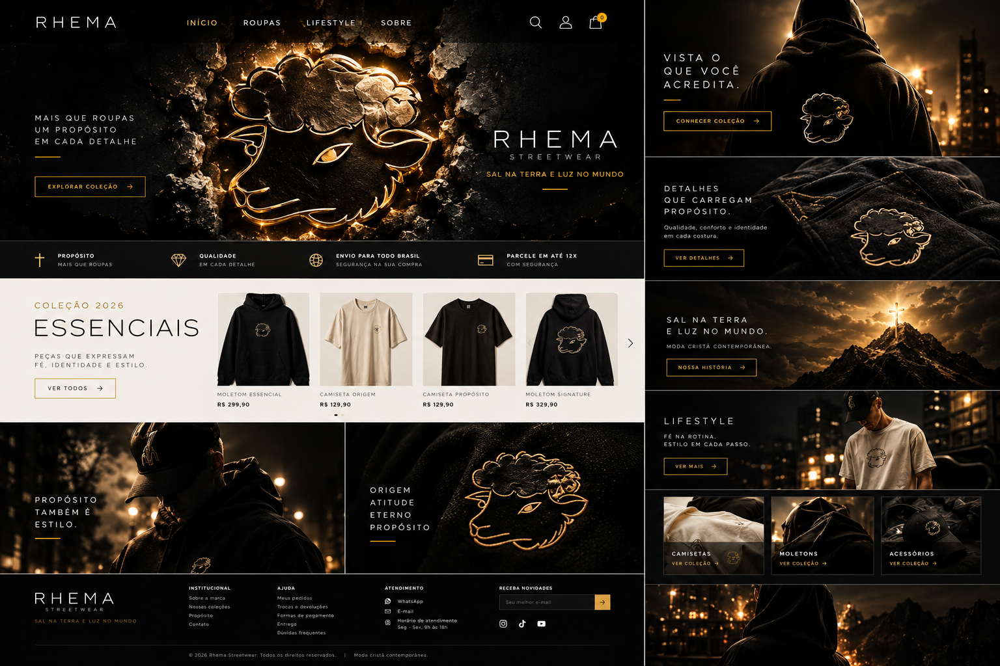
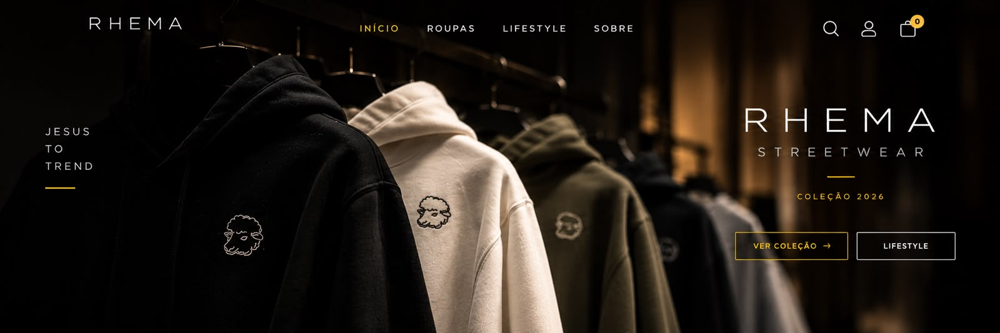
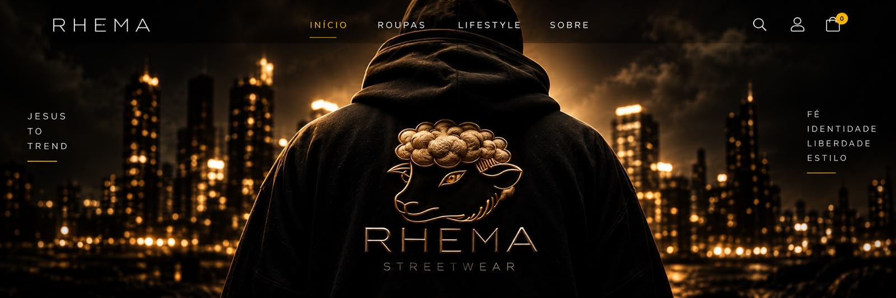
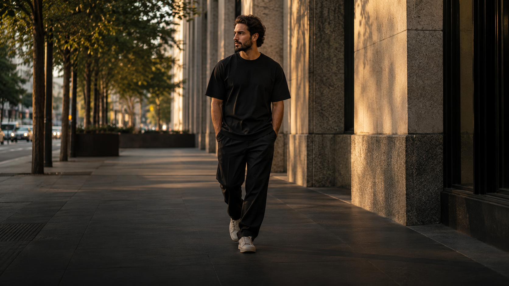

# Manual Unificado RHEMA

**Guia passo a passo de desenvolvimento web**  
**Versão:** 2.0  
**Data:** 28/10/2026

**Status:** Fases 1 a 7 e Revisão R1 mantidas como histórico. As microetapas 9.1 a 9.9 estão implementadas e revisadas. Na Fase 8, as etapas 8.1 a 8.3 e 8.5 a 8.10 têm implementação; 8.4 está parcial, e a revisão visual completa da homepage (8.11) continua pendente. A página Sobre tem interface própria e formulário de testemunhos; a publicação compartilhada aguarda a ativação do Supabase.

> Este documento reúne o guia inicial do projeto e as etapas retificadas da identidade visual. Avance uma microetapa por vez. O site já contém a estrutura das etapas 8.4 a 8.10; confira o estado atual na tabela de progresso antes de repetir qualquer código. O item **Histórias** abre a página `sobre.html`, separada da homepage. O mural global depende de um banco online ativo; veja `database/rhema_testimonies.sql`.

---

## Prefácio

### Por que aprender programação?

Programação é uma habilidade fundamental do século XXI. Ela te ensina a:
- Pensar de forma lógica e estruturada
- Resolver problemas complexos dividindo-os em partes menores
- Criar soluções reais que podem ser usadas por outras pessoas
- Desenvolver autonomia e capacidade de aprendizado contínuo

### O que você vai conquistar

Ao final deste projeto, você terá:
- ✅ Um site funcional e profissional (RHEMA - streetwear cristão)
- ✅ Conhecimento sólido em HTML, CSS e JavaScript
- ✅ Experiência prática com desenvolvimento web completo
- ✅ Um portfólio real para mostrar em entrevistas
- ✅ Autonomia para criar novos projetos sem depender de terceiros

---

## Introdução

### Sobre o projeto RHEMA

A RHEMA é uma marca de roupas **streetwear cristã** que você está criando como seu primeiro projeto completo. O objetivo é construir uma **loja virtual moderna**, começando pelo front-end e evoluindo até um e-commerce completo.

#### O que o site precisa ter:

| Funcionalidade | Status |
|---------------|--------|
| Página inicial apresentando a marca | ✅ Concluído |
| Catálogo de produtos | ✅ Concluído |
| Páginas individuais de produto | ✅ Concluído (o produto vem do `?id=` da URL, R1.6) |
| Carrinho de compras | ✅ Concluído (o erro do botão foi corrigido na R1.2) |
| Filtros e busca | Busca por nome (sem distinção de acentos) e filtro por categoria concluídos; filtro por tamanho ainda não existe |
| Responsividade | ✅ Concluído (`viewport` na R1.1 e `@media` na R1.7) |
| Visual luxuoso e clean | Etapas 8.1 a 8.3 e 8.5 a 8.10 implementadas; 8.4 parcial; 8.11 pendente |
| Devocional diário e interatividade | ✅ Fase 9.1 a 9.9 implementadas e revisadas |
| Sistema de login/cadastro | ⏳ Fase 10 escrita |
| Back-end e banco de dados | ⏳ Fase 11 escrita |

#### Categorias atuais da identidade

1. Camisetas
2. Moletons
3. Calças
4. Acessórios
5. Lifestyle

Os cinco atalhos da homepage filtram o catálogo. A jaqueta está associada à categoria Lifestyle até a organização comercial ser definida. O arquivo de direção de arte em Word traz uma lista menor, com três atalhos; a versão do site segue a lista completa da identidade visual.

#### Identidade visual:

- Minimalista
- Sofisticada
- Urbana
- Com referências cristãs

### Tecnologias que vamos usar

| Tecnologia | Função | Por que escolher esta? |
|-----------|--------|------------------------|
| **HTML5** | Estrutura do site | Padrão universal, essencial |
| **CSS3** | Estilos e layout | Nativo, poderoso, responsivo |
| **JavaScript** | Interatividade | Aprende lógica sem dependências |
| **LocalStorage** | Dados temporários | Gratuito, simples, para testes |

#### Vantagens desta escolha:

- ✅ **Gratuitas** - não custa nada aprender
- ✅ **Nativas** - funcionam em qualquer navegador
- ✅ **Bem documentadas** - muita ajuda disponível
- ✅ **Base sólida** - depois você pode migrar para frameworks
- ✅ **Fáceis de testar** - só precisa de um navegador

---

## Fase 1: Estrutura Básica

*Objetivo: Criar a fundação do projeto*

### 📍 Microetapa 1.1: Criar estrutura de pastas

**Objetivo**
Criar os arquivos e pastas básicos que o projeto precisa.

**Código**
```
passo-a-passo-com-assistencia/
├── index.html
├── produtos.html
├── produto.html
├── carrinho.html
├── css/
│   └── styles.css
├── js/
│   └── main.js
└── imagens/
```

**Como Testar**
1. Abra o explorador de arquivos
2. Crie as pastas `css`, `js` e `imagens` dentro do projeto
3. Crie os arquivos vazios listados acima

**Resultado Esperado**
Você deve ver todos os arquivos e pastas criados na estrutura acima.

✅ Checklist
- [x] Criei a pasta `css`
- [x] Criei a pasta `js`
- [x] Criei a pasta `imagens`
- [x] Criei os arquivos `index.html`, `produtos.html`, `produto.html`
- [x] Criei os arquivos `styles.css` e `main.js`

---

### 📍 Microetapa 1.2: HTML inicial da página inicial

**Objetivo**
Criar a estrutura HTML básica do arquivo `index.html`.

**Conceito Novo**
- **HTML (HyperText Markup Language)**: Linguagem que define a estrutura de páginas web. Cada elemento é marcado com tags como `<html>`, `<head>`, `<body>`.
- **Tag**: Elemento HTML que começa com `<` e termina com `>`. Ex: `<h1>` é um título principal.
- **Atributo**: Informação extra dentro de tags. Ex: `lang="pt"` no `<html>`.

**Código**
```html
<!DOCTYPE html>
<html lang="pt">
<head>
  <meta charset="UTF-8">
  <title>RHEMA | Streetwear Cristão</title>
</head>
<body>
  <header>
    <h1>RHEMA</h1>
    <p>Streetwear cristão com identidade urbana</p>
  </header>
  
  <main>
    <h2>Coleções</h2>
    <ul>
      <li><a href="produtos.html">Básicos</a></li>
      <li><a href="produtos.html">Oversize</a></li>
      <li><a href="produtos.html">Streetwear</a></li>
      <li><a href="produtos.html">Sporting</a></li>
    </ul>
  </main>
  
  <footer>
    <p>&copy; 2026 RHEMA. Todos os direitos reservados.</p>
  </footer>
</body>
</html>
```

**Como Testar**
1. Abra `index.html` no seu navegador (clique duplo)
2. Você deve ver o título "RHEMA" e o texto da marca
3. Deve ver uma lista com as 4 categorias

**Resultado Esperado**
Uma página simples com título, subtítulo, lista de categorias e rodapé.

✅ Checklist
- [x] Criei o arquivo `index.html`
- [x] Abri no navegador e vi o conteúdo
- [x] Entendi o que cada tag faz
- [x] O título está correto
- [x] As categorias aparecem como lista

---

### 📍 Microetapa 1.3: CSS básico para estilização

**Objetivo**
Criar a estrutura básica do arquivo `styles.css` para dar estilo ao site.

**Conceito Novo**
- **CSS (Cascading Style Sheets)**: Linguagem que define cores, fontes, espaçamentos e layouts.
- **Seletor**: Identifica qual elemento estilizar. Ex: `h1` estiliza todos os títulos.
- **Declaração**: Regra CSS com propriedade e valor. Ex: `color: red;`

**Código**
```css
/* Reset básico */
* {
  margin: 0;
  padding: 0;
  box-sizing: border-box;
}

/* Estilos para corpo do documento */
body {
  font-family: Arial, sans-serif;
  line-height: 1.6;
  padding: 20px;
  background-color: #f5f5f5;
  color: #2c2626;
}

/* Estilos para cabeçalho */
header {
  text-align: center;
  margin-bottom: 40px;
}

header h1 {
  font-size: 36px;
  letter-spacing: 4px;
  margin-bottom: 10px;
}

header p {
  font-size: 16px;
  color: #2c2626;
}

/* Estilos para conteúdo principal */
main {
  max-width: 800px;
  margin: 0 auto;
  background: white;
  padding: 30px;
  border-radius: 8px;
}

main h2 {
  font-size: 24px;
  margin-bottom: 20px;
}

main ul {
  list-style: none;
}

main ul li {
  padding: 12px 0;
  border-bottom: 1px solid #eee;
}

main ul li:last-child {
  border-bottom: none;
}

main ul li a {
  text-decoration: none;
  color: #2c2626;
  font-size: 18px;
}

main ul li a:hover {
  color: #000;
  text-decoration: underline;
}

/* Estilos para rodapé */
footer {
  text-align: center;
  margin-top: 40px;
  font-size: 14px;
  color: #888;
}
```

**Como Testar**
1. Adicione esta linha no `<head>` do `index.html`:
   ```html
   <link rel="stylesheet" href="css/styles.css">
   ```
2. Recarregue a página no navegador
3. Veja as melhorias visuais

**Resultado Esperado**
- Fundo cinza claro
- Conteúdo branco centralizado
- Fonte Arial mais limpa
- Espaçamento melhorado
- Links com efeito ao passar o mouse

✅ Checklist
- [x] Criei o arquivo `css/styles.css`
- [x] Adicionei o link no `index.html`
- [x] Recarreguei e vi as mudanças
- [x] Entendi o que cada seletor faz
- [x] Testei o hover nos links

---

## ✅ Fase 1 Concluída!

Parabéns! Você criou a estrutura básica do projeto. Agora vamos para a próxima fase.

---

## Fase 2: Página Inicial

*Objetivo: Criar a página inicial completa com hero section e apresentação*

### 📍 Microetapa 2.1: Adicionar seção de destaque (Hero)

**Objetivo**
Adicionar uma seção visual impactante que apresenta a marca antes dos produtos.

**Conceito Novo**
**Hero Section** é o primeiro grande bloco que o usuário vê ao abrir o site. 
Usamos gradiente para dar profundidade e aspecto profissional. 
O gradiente transita entre duas cores de forma suave.

**Onde Digitar**
📁 Arquivo: `index.html`
📍 Local: Após `</header>` e antes de `<main>`

**Fragmento 1 (HTML)**
```html
<section class="hero">
  <div class="hero-content">
    <h2>Identidade Urbana</h2>
    <p>Moda cristã com estilo e propósito</p>
    <a href="produtos.html" class="btn">Ver Coleções</a>
  </div>
</section>
```

**Explicação do Fragmento 1**
- `<section class="hero">`: cria um bloco semântico com nome para CSS
- `<div class="hero-content">`: agrupa o conteúdo da hero
- `<h2>`: título secundário (o h1 já é o logo RHEMA)
- `<p>`: subtítulo descritivo
- `<a class="btn">`: link que será transformado em botão

**Onde Digitar**
📁 Arquivo: `css/styles.css`
📍 Local: No final do arquivo

**Fragmento 2 (CSS)**
```css
/* Seção Hero */
.hero {
  background: linear-gradient(135deg, #1a1a1a 0%, #2d2d2d 100%);
  color: white;
  text-align: center;
  padding: 80px 20px;
  margin-bottom: 40px;
  border-radius: 8px;
}

.hero h2 {
  font-size: 32px;
  margin-bottom: 15px;
}

.hero p {
  font-size: 18px;
  margin-bottom: 30px;
  opacity: 0.9;
}

.btn {
  display: inline-block;
  background: white;
  color: #1a1a1a;
  padding: 12px 30px;
  text-decoration: none;
  border-radius: 5px;
  font-weight: bold;
  transition: background 0.3s;
}

.btn:hover {
  background: #f0f0f0;
}
```

**Explicação do Fragmento 2**
- `linear-gradient`: cria transição diagonal entre cores
- `#1a1a1a 0%`: cor inicial (quase preto)
- `#2d2d2d 100%`: cor final (cinza escuro)
- `padding`: espaço interno (80px vertical, 20px horizontal)
- `border-radius`: bordas arredondadas

**Como Testar**
1. Salve os dois arquivos
2. Abra `index.html` no navegador
3. Recarregue a página (F5)
4. Deve aparecer seção cinza acima da lista de coleções

**Resultado Esperado**
- Seção escura com gradiente visível
- Texto "Identidade Urbana" em branco
- Botão "Ver Coleções" com fundo branco

**Exercício 1**
Mude o gradiente para usar preto (#000) e verde escuro (#1a472a)

**Exercício 2**
Aumente o padding para 100px vertical para dar mais espaço

✅ Checklist
- [x] Criei a seção no HTML
- [x] Escrevi o CSS
- [x] Testei no navegador
- [x] Completei os exercícios
- [x] Entendi o conceito de gradiente

> **Nota:** no primeiro teste, a seção não apareceu como esperado no navegador. A correção foi feita depois (registrada no `PROGRESSO.md` como "2.1 - Seção Hero (corrigida)"), e a versão final está no `index.html` e no `styles.css` do projeto.

---

### 📍 Microetapa 2.2: Adicionar links de navegação

**Objetivo**
Adicionar uma barra de navegação no topo do site para fácil acesso às páginas.

**Conceito Novo**
**Flexbox** é uma técnica CSS para alinhar elementos horizontalmente.
Usamos `display: flex` para criar uma linha de itens lado a lado.

**Onde Digitar**
📁 Arquivo: `index.html`
📍 Local: Após `</header>` e antes da seção `.hero`

**Fragmento 1 (HTML)**
```html
<nav class="main-nav">
  <a href="index.html">Início</a>
  <a href="produtos.html">Produtos</a>
  <a href="#">Coleções</a>
  <a href="#">Sobre</a>
  <a href="#">Contato</a>
</nav>
```

**Explicação do Fragmento 1**
- `<nav>`: elemento semântico para navegação
- `<a>`: cada link é uma âncora
- `href`: define para onde o link leva

**Onde Digitar**
📁 Arquivo: `css/styles.css`
📍 Local: Após o CSS da hero

**Fragmento 2 (CSS)**
```css
/* Navegação principal */
.main-nav {
  display: flex;
  justify-content: center;
  gap: 20px;
  margin-bottom: 30px;
}

.main-nav a {
  color: #333;
  text-decoration: none;
  font-size: 14px;
  padding: 8px 16px;
  border-radius: 4px;
  transition: background 0.3s;
}

.main-nav a:hover {
  background: #e0e0e0;
}

.main-nav a.active {
  background: #1a1a1a;
  color: white;
}
```

**Explicação do Fragmento 2**
- `display: flex`: cria linha horizontal de links
- `justify-content: center`: centraliza horizontalmente
- `gap: 20px`: espaço entre links
- `transition`: animação suave no hover

**Como Testar**
1. Salve os dois arquivos
2. Abra `index.html` no navegador
3. Recarregue a página
4. Passe o mouse sobre os links

**Resultado Esperado**
- Links alinhados horizontalmente acima da hero
- Efeito hover (fundo cinza claro)
- Links funcionam para páginas diferentes

**Exercício 1**
Adicione um novo link "Promoções" na navegação

**Exercício 2**
Mude o gap para 30px para aumentar o espaço entre links

✅ Checklist
- [x] Criei o `<nav>` no HTML
- [x] Escrevi o CSS da navegação
- [x] Testei os links
- [x] Completei os exercícios
- [x] Entendi o flexbox

---

## ✅ Fase 2 Concluída!

Parabéns! Você criou a página inicial com Hero e navegação. Continue para a próxima fase.

---

## Fase 3: Catálogo de Produtos

*Objetivo: Criar a página de catálogo com produtos exibidos em grade*

### 📍 Microetapa 3.1: Estrutura de produtos

**Objetivo**
Criar cards de produtos para exibir no catálogo.

**Conceito Novo**
- **Card**: Elemento que agrupa informações de um produto (imagem, nome, preço).
- **Grid**: Layout CSS que organiza elementos em linhas e colunas.

**Código**
Adicione no `produtos.html`:

```html
<div class="product-grid">
  <div class="product-card">
    <div class="product-image">[IMAGEM: Camiseta]</div>
    <h3>Camiseta Básica</h3>
    <p class="price">R$ 59,90</p>
    <a href="produto.html" class="btn-small">Ver Detalhes</a>
  </div>
  
  <div class="product-card">
    <div class="product-image">[IMAGEM: Hoodie]</div>
    <h3>Hoodie Oversize</h3>
    <p class="price">R$ 149,90</p>
    <a href="produto.html" class="btn-small">Ver Detalhes</a>
  </div>
  
  <div class="product-card">
    <div class="product-image">[IMAGEM: Boné]</div>
    <h3>Boné RHEMA</h3>
    <p class="price">R$ 49,90</p>
    <a href="produto.html" class="btn-small">Ver Detalhes</a>
  </div>
</div>
```

Adicione no `styles.css`:

```css
/* Grid de produtos */
.product-grid {
  display: grid;
  grid-template-columns: repeat(auto-fit, minmax(250px, 1fr));
  gap: 30px;
  margin-top: 30px;
}

.product-card {
  background: white;
  border-radius: 8px;
  padding: 20px;
  text-align: center;
  box-shadow: 0 2px 5px rgba(0,0,0,0.1);
}

.product-image {
  width: 100%;
  height: 200px;
  background: #f0f0f0;
  border-radius: 5px;
  margin-bottom: 15px;
  display: flex;
  align-items: center;
  justify-content: center;
  color: #888;
}

.product-card h3 {
  font-size: 18px;
  margin-bottom: 10px;
}

.price {
  color: #1a1a1a;
  font-weight: bold;
  margin-bottom: 15px;
}

.btn-small {
  display: inline-block;
  padding: 8px 20px;
  background: #1a1a1a;
  color: white;
  text-decoration: none;
  border-radius: 4px;
  font-size: 14px;
}

.btn-small:hover {
  background: #333;
}
```

**Como Testar**
1. Abra `produtos.html`
2. Verifique se os cards aparecem em grade
3. Teste o hover nos botões

**Resultado Esperado**
- Produtos em grade responsiva
- Cards com imagem, nome e preço
- Botão "Ver Detalhes"

✅ Checklist
- [x] Adicionei os cards
- [x] Adicionei o CSS
- [x] Testei a grade
- [x] Entendi o grid

---

## Fase 4: Página do Produto

*Objetivo: Criar página detalhada para cada produto*

### 📍 Microetapa 4.1 — Layout da página de produto

**O que vamos fazer?**
Criar o arquivo `produto.html` com layout de detalhes do produto: imagem grande, nome, preço, descrição, seletor de tamanho e botão "Adicionar ao Carrinho".

**Por que precisamos disso?**
O catálogo (Fase 3) tem links para `produto.html?id=1`, etc. Sem esta página, o usuário clica e dá erro 404. É a ponte entre listar produtos e ver detalhes — essencial para qualquer e-commerce.

**Implementação**

Substitua o conteúdo do `produto.html`:

```html
<!DOCTYPE html>
<html lang="pt">
<head>
  <meta charset="UTF-8">
  <title>Produto | RHEMA</title>
  <link rel="stylesheet" href="css/styles.css">
</head>
<body>
  <header>
    
    <p>O jeito certo de vestir a fé.</p>
  </header>

  <nav class="main-nav">
    <a href="index.html">Início</a>
    <a href="produtos.html">Produtos</a>
    <a href="#">Coleção</a>
    <a href="#">Contato</a>
    <a href="#">Sobre</a>
  </nav>

  <main>
    <div class="product-detail">
      <div class="product-image-large">
        [IMAGEM: Produto em destaque]
      </div>
      <div class="product-info">
        <h1>Camiseta Básica RHEMA</h1>
        <p class="product-price">R$ 59,90</p>
        <p class="product-description">
          Camiseta básica com corte moderno e tecido de alta qualidade.
          Perfeita para o dia a dia com conforto e estilo.
        </p>

        <div class="product-options">
          <label>Tamanho:</label>
          <select>
            <option>P</option>
            <option>M</option>
            <option>G</option>
            <option>GG</option>
          </select>
        </div>

        <button class="btn btn-cart">Adicionar ao Carrinho</button>
      </div>
    </div>
  </main>

  <footer>
    
    <p>&copy; 2026 RHEMA. Todos os direitos reservados.</p>
  </footer>
  <script src="js/main.js"></script>
</body>
</html>
```

**Entendendo o código**
- `product-detail` usa CSS Grid (já está no `styles.css`) para colocar imagem e info lado a lado
- `select` permite escolher tamanho — necessário antes de adicionar ao carrinho
- Botão com classe `btn-cart` — o JS do `main.js` escuta esse clique (código da Fase 5)

**Teste**
1. Salve o arquivo
2. Abra `produto.html` no navegador
3. Verifique layout lado a lado (imagem esquerda, info direita)
4. Teste o seletor de tamanho

**Resultado esperado**
- Página com imagem grande à esquerda e infos à direita
- Seletor de tamanho funcional
- O botão só passa a adicionar produtos ao carrinho depois da Fase 5

**Próximo passo**
Fase 5.1 — fazer o botão adicionar o produto ao carrinho.

✅ Checklist
- [x] Criei o `produto.html`
- [x] Testei o layout
- [x] Testei o seletor de tamanho

---

## Fase 5: Carrinho de Compras

*Objetivo: Implementar o carrinho usando JavaScript e LocalStorage*

### 📍 Microetapa 5.1: Adicionar produto ao carrinho

**Objetivo**
Criar a funcionalidade que adiciona o produto ao carrinho quando o botão é clicado.

**Conceito Novo**
- **JavaScript (JS)**: Linguagem que adiciona interatividade ao site.
- **LocalStorage**: Armazenamento no navegador para guardar dados sem banco de dados.
- **JSON**: Formato de texto para guardar dados. O LocalStorage só guarda texto, então convertemos o array em texto (`JSON.stringify`) para salvar e de volta em array (`JSON.parse`) para ler.

**Código**
No `js/main.js`, adicione:

```javascript
// Produto exibido nesta página
const produtoAtual = {
  id: 1,
  nome: 'Camiseta Básica RHEMA',
  preco: 59.90
};

// Adicionar produto ao carrinho
document.querySelector('.btn-cart').addEventListener('click', function() {
  // Pega o carrinho do localStorage ou cria um vazio se não existir
  const carrinho = JSON.parse(localStorage.getItem('carrinho')) || [];

  // Verifica se o produto já está no carrinho
  const indexExistente = carrinho.findIndex(item => item.id === produtoAtual.id);

  if (indexExistente === -1) {
    // Adiciona o produto ao carrinho
    carrinho.push(produtoAtual);
    // Salva o carrinho atualizado no navegador
    localStorage.setItem('carrinho', JSON.stringify(carrinho));

    // Avisa o usuário
    alert(`"${produtoAtual.nome}" adicionado ao carrinho!`);
  } else {
    // Avisa que o produto já está lá
    alert('Este produto já está no carrinho!');
  }
});
```

**Entendendo o código**
- `const produtoAtual = {...}`: objeto com os dados do produto (id, nome, preço). Por enquanto é sempre a Camiseta Básica.
- `document.querySelector('.btn-cart')`: encontra o botão "Adicionar ao Carrinho" pela classe.
- `.addEventListener('click', function() {...})`: executa a função toda vez que o botão é clicado.
- `localStorage.getItem('carrinho')`: lê o texto salvo com o nome `carrinho`.
- `JSON.parse(...) || []`: converte o texto em array; se não existir nada salvo, usa um array vazio `[]`.
- `carrinho.findIndex(item => item.id === produtoAtual.id)`: procura a posição do produto no carrinho; devolve `-1` se não achar.
- `if (indexExistente === -1)`: se o produto não está no carrinho, adiciona.
- `carrinho.push(produtoAtual)`: coloca o produto no fim do array.
- `localStorage.setItem('carrinho', JSON.stringify(carrinho))`: converte o array em texto e salva.
- `alert(...)`: mostra a mensagem. As crases `` ` `` permitem colocar variáveis dentro do texto com `${...}`.

**Como Testar**
1. Abra `produto.html`
2. Clique em "Adicionar ao Carrinho" — deve aparecer o alerta de sucesso
3. Clique de novo — deve aparecer "Este produto já está no carrinho!"
4. No navegador, aperte F12 → aba Application → Local Storage e veja a chave `carrinho`

**Resultado Esperado**
- Alerta de sucesso na primeira vez e de aviso na segunda
- Produto salvo no navegador

> **Atenção:** esta linha `document.querySelector('.btn-cart')` só funciona em `produto.html`. Nas outras páginas o botão não existe, o resultado é `null` e o JavaScript dá erro, parando o resto do arquivo. Isso foi corrigido na microetapa **R1.2**. O código final deste bloco, que lê o produto pela URL e guarda o tamanho escolhido, está na **R1.6**.

✅ Checklist
- [x] Adicionei o JavaScript
- [x] Testei o clique
- [x] Entendi o localStorage

---

### 📍 Microetapa 5.2 — Visualizar carrinho (substituída)

Esta microetapa previa mostrar o carrinho dentro do `produtos.html`. No projeto, a decisão foi criar uma **página própria**, o `carrinho.html`, na Fase 7. Por isso não há código aqui: veja as microetapas 7.1 e 7.2.

---

## Fase 6: Filtros e Busca

*Objetivo: Adicionar funcionalidade para filtrar produtos*

### 📍 Microetapa 6.1 — Campo de busca

**O que vamos fazer?**
Adicionar um campo de texto no `produtos.html` que filtra os produtos em tempo real conforme o usuário digita.

**Por que precisamos disso?**
Com muitos produtos, o usuário precisa buscar por nome. É uma funcionalidade essencial para navegar o catálogo.

**Implementação**

No `produtos.html`, adicione após o `<h1>Catálogo</h1>`:

```html
<div class="search-container">
  <input type="text" id="search-input" placeholder="Buscar produtos...">
</div>
```

No `js/main.js`, adicione:

```javascript
const input = document.getElementById('search-input');
const produtos = document.querySelectorAll('.product-card');

if (input) {
  input.addEventListener('input', function() {
    const termo = input.value.toLowerCase();

    produtos.forEach(function(produto) {
      const nome = produto.querySelector('h3').textContent.toLowerCase();
      if (nome.includes(termo)) {
        produto.style.display = 'block';
      } else {
        produto.style.display = 'none';
      }
    });
  });
}
```

**Entendendo o código**
- `getElementById('search-input')` — pega o campo de texto
- `querySelectorAll('.product-card')` — seleciona todos os cards de produto
- `if (input)` — só liga a busca se o campo existir; nas outras páginas ele não existe e o `if` evita erro
- `addEventListener('input', ...)` — escuta cada digitação em tempo real
- `toLowerCase()` — converte para minúsculas para comparação case-insensitive
- `includes(termo)` — verifica se o nome contém o termo digitado
- `style.display = 'block/none'` — mostra ou esconde o card

**Teste**
1. Digite "camiseta" no campo
2. Só deve aparecer a Camiseta Básica
3. Apague o texto — todos os produtos voltam

**Resultado esperado**
- Campo de busca funcional
- Produtos filtrados em tempo real
- Case-insensitive (não diferencia maiúsculas/minúsculas)

> **Nota:** a primeira versão tinha um erro de digitação (`productos`) dentro do `forEach`, e `produtos.html` não carregava o `main.js`. Os dois problemas foram corrigidos nas microetapas **R1.1** e **R1.3**.

**Próximo passo**
Fase 7.1 — criar a página do carrinho.

✅ Checklist
- [x] Adicionei o campo de busca no HTML
- [x] Escrevi o JavaScript da busca
- [x] Entendi o `if (input)`

---

## Fase 7: Página do Carrinho

*Objetivo: Criar a página que mostra os produtos guardados no carrinho*

### 📍 Microetapa 7.1 — Criar a página do carrinho (carrinho.html)

**O que vamos fazer?**
Criar o arquivo `carrinho.html` com cabeçalho, navegação, uma área vazia para os itens e uma área para o total.

**Por que precisamos disso?**
A Fase 5 salva os produtos no LocalStorage, mas o usuário ainda não tem onde ver o que escolheu. Esta página é o lugar onde os itens vão aparecer.

**Implementação**

Crie o `carrinho.html`:

```html
<!DOCTYPE html>
<html lang="pt">
<head>
  <meta charset="UTF-8">
  <title>Carrinho | RHEMA</title>
  <link rel="stylesheet" href="css/styles.css">
</head>
<body>
  <header>
    
    <p>O jeito certo de vestir a fé.</p>
  </header>

  <nav class="main-nav">
    <a href="index.html">Início</a>
    <a href="produtos.html">Produtos</a>
    <a href="#">Coleção</a>
    <a href="#">Contato</a>
    <a href="#">Sobre</a>
  </nav>

  <main>
    <h1>Seu Carrinho</h1>
    <div id="cart-items">
      <!-- Itens serão injetados pelo JavaScript -->
    </div>
    <div id="cart-total" style="text-align: right; margin-top: 20px; font-size: 18px; font-weight: bold;"></div>
  </main>

  <footer>
    
    <p>&copy; 2026 RHEMA. Todos os direitos reservados.</p>
  </footer>
  <script src="js/main.js"></script>
</body>
</html>
```

**Entendendo o código**
- O cabeçalho, a navegação e o rodapé repetem a estrutura das outras páginas, para o site ter a mesma aparência.
- `<h1>Seu Carrinho</h1>`: título principal da página.
- `<div id="cart-items">`: caixa vazia. O `id` permite que o JavaScript encontre essa caixa e coloque os produtos dentro dela.
- `<!-- ... -->`: comentário; o navegador ignora.
- `<div id="cart-total" style="...">`: caixa do total. O atributo `style` aplica CSS direto na tag: texto à direita, espaço acima, fonte maior e em negrito.
- `<script src="js/main.js"></script>`: fica no fim do `<body>` para carregar o JavaScript depois que o HTML já existe.

**Teste**
1. Abra `carrinho.html` no navegador
2. Veja o título "Seu Carrinho" com o cabeçalho e o rodapé do site

**Resultado esperado**
A página aparece com título e sem itens; eles chegam na microetapa 7.2.

✅ Checklist
- [x] Criei o `carrinho.html`
- [x] Abri no navegador
- [x] Entendi para que servem os `id`

---

### 📍 Microetapa 7.2 — Renderizar o carrinho com JavaScript

**O que vamos fazer?**
Ler o carrinho do LocalStorage e desenhar cada produto na página, com o total e um botão "Remover".

**Por que precisamos disso?**
Sem isso a página fica vazia. É aqui que o usuário vê o que escolheu.

**Conceito Novo**
- **Renderizar**: desenhar na tela, via JavaScript, conteúdo que não estava no HTML.
- **DOMContentLoaded**: evento do navegador que avisa quando o HTML terminou de carregar.
- **Template string**: texto entre crases `` ` `` que aceita variáveis com `${...}`.

**Implementação**

No `js/main.js`, adicione:

```javascript
document.addEventListener('DOMContentLoaded', function() {
  // Apenas executa se estivermos na página do carrinho
  if (document.getElementById('cart-items')) {
    const carrinho = JSON.parse(localStorage.getItem('carrinho')) || [];
    const cartItemsContainer = document.getElementById('cart-items');
    const cartTotalElement = document.getElementById('cart-total');

    if (carrinho.length === 0) {
      cartItemsContainer.innerHTML = '<p>Carrinho vazio</p>';
      cartTotalElement.textContent = 'Total: R$ 0,00';
    } else {
      let total = 0;
      cartItemsContainer.innerHTML = ''; // Limpa o conteúdo existente

      carrinho.forEach(function(item, index) {
        cartItemsContainer.innerHTML += `
          <div class="cart-item">
            <span class="cart-item-name">${item.nome}</span>
            <span class="cart-item-price">R$ ${item.preco.toFixed(2)}</span>
            <button class="cart-item-remove" data-index="${index}">Remover</button>
          </div>
        `;
        total += item.preco;
      });

      cartTotalElement.textContent = `Total: R$ ${total.toFixed(2)}`;

      // Adiciona evento para os botões de remover
      document.querySelectorAll('.cart-item-remove').forEach(function(button, index) {
        button.addEventListener('click', function() {
          const carrinho = JSON.parse(localStorage.getItem('carrinho')) || [];
          carrinho.splice(index, 1); // Remove o item pelo índice
          localStorage.setItem('carrinho', JSON.stringify(carrinho));
          location.reload(); // Recarrega a página para atualizar a visualização
        });
      });
    }
  }
});
```

**Entendendo o código**
- `document.addEventListener('DOMContentLoaded', ...)`: só roda o código depois que a página carregou.
- `if (document.getElementById('cart-items'))`: roda apenas se existir a caixa `cart-items`, isto é, na página do carrinho.
- `JSON.parse(localStorage.getItem('carrinho')) || []`: lê o carrinho salvo (ou um array vazio).
- `cartItemsContainer` e `cartTotalElement`: guardam as duas caixas do HTML em variáveis.
- `if (carrinho.length === 0)`: se não há itens, mostra "Carrinho vazio" e o total zerado.
- `let total = 0;`: variável que vai somar os preços.
- `cartItemsContainer.innerHTML = ''`: esvazia a caixa antes de desenhar.
- `carrinho.forEach(function(item, index) {...})`: repete o bloco para cada produto; `item` é o produto e `index` é a posição dele.
- `innerHTML += ...`: acrescenta um bloco HTML por produto, com `${item.nome}` e `${item.preco.toFixed(2)}` (duas casas decimais).
- `data-index="${index}"`: guarda a posição do produto no botão "Remover".
- `total += item.preco`: soma o preço ao total.
- `cartTotalElement.textContent = ...`: escreve o total na tela.
- `querySelectorAll('.cart-item-remove').forEach(...)`: liga um clique a cada botão "Remover".
- `carrinho.splice(index, 1)`: remove 1 item na posição `index`.
- `localStorage.setItem(...)`: salva o carrinho já sem o item.
- `location.reload()`: recarrega a página para mostrar a lista atualizada.

**Teste**
1. Em `produto.html`, clique em "Adicionar ao Carrinho"
2. Abra `carrinho.html`
3. Veja o nome, o preço, o botão "Remover" e o total
4. Clique em "Remover" e veja o carrinho esvaziar

**Resultado esperado**
- Lista de produtos com o total somado
- "Carrinho vazio" quando não há itens
- "Remover" tira o item da lista

> **Atenção:** se o erro da microetapa 5.1 (`.btn-cart` sem `if`) ainda estiver no `main.js`, o script para antes de chegar aqui e o carrinho pode aparecer vazio mesmo com produtos salvos. Isso foi corrigido na **R1.2**. Os preços apareciam com ponto (`59.90`); na **R1.6** foi criada a função `formatarPreco`, que mostra vírgula.

✅ Checklist
- [x] Escrevi o JavaScript de renderização
- [x] Entendi `forEach`, `innerHTML` e `splice`
- [x] Confirmei no navegador que os itens aparecem (após a R1.2)

---

## ✅ Fase 7 Concluída!

Você criou a página do carrinho. Antes do login, vamos fazer a Revisão R1 para consertar o que a análise encontrou.

---

## Revisão R1: Correções após a análise

*Objetivo: Corrigir problemas encontrados ao revisar todos os arquivos (14/10/2026)*

Os problemas abaixo foram encontrados **lendo o código** e ainda não foram confirmados no navegador. Cada microetapa é pequena e testável.

| Microetapa | O que corrige | Arquivo | Status |
|-----------|---------------|---------|--------|
| R1.1 | `viewport`, script em `produtos.html`, links, `lang`, logo, label | HTMLs | ✅ Concluída |
| R1.2 | Proteger o botão do carrinho (`if`) | `main.js` | ✅ Concluída |
| R1.3 | `productos` → `produtos` na busca | `main.js` | ✅ Concluída |
| R1.4 | Legibilidade: fundo do `main` e cores | `styles.css` | ✅ Concluída |
| R1.5 | Estilizar a home e o carrinho | `styles.css` + HTML | ✅ Concluída |
| R1.6 | Ligar `produto.html` ao `?id=` da URL | `main.js` + HTML | ✅ Concluída |
| R1.7 | Responsividade (`@media`) e hover dos cards | `styles.css` | ✅ Concluída |

As microetapas R1.3 a R1.7 foram testadas em um navegador automatizado (Chromium). Falta você conferir no seu navegador.

### 📍 Microetapa R1.1 — Correções no HTML

**O que vamos fazer?**
Substituir os 4 arquivos HTML (`index.html`, `produtos.html`, `produto.html`, `carrinho.html`) pelas versões reescritas, com 6 ajustes.

**Por que precisamos disso?**
Sem a tag `viewport` o site não se adapta ao celular; sem o `<script>` em `produtos.html` a busca nunca é carregada; e links quebrados levam a erro 404.

**Implementação**

1. Em todas as páginas, dentro do `<head>`, depois de `<meta charset="UTF-8">`:

```html
<meta name="viewport" content="width=device-width, initial-scale=1.0">
```

2. Em `produtos.html`, antes de `</body>`:

```html
<script src="js/main.js"></script>
```

3. Em `produtos.html`, os links que apontavam para páginas inexistentes passam a usar `#`, como nas outras páginas:

```html
<a href="#">Coleção</a>
<a href="#">Contato</a>
<a href="#">Sobre</a>
```

4. Em todas as páginas, o idioma passa a ser português do Brasil:

```html
<html lang="pt-BR">
```

5. No rodapé de `index.html`, o logo passa a ser o mesmo das outras páginas, e o clique volta ao topo:

```html

```

6. Em `produto.html`, o rótulo do tamanho é ligado ao campo:

```html
<label for="tamanho">Tamanho:</label>
<select id="tamanho">
```

**Entendendo o código**
- `name="viewport"`: instrução para o navegador do celular sobre como mostrar a página.
- `width=device-width`: usa a largura real da tela do aparelho.
- `initial-scale=1.0`: começa sem zoom.
- `<script src="js/main.js">`: carrega o arquivo JavaScript; precisa ficar no fim do `<body>`.
- `href="#"`: link que não leva a lugar nenhum (ainda), em vez de levar a uma página inexistente.
- `lang="pt-BR"`: informa o idioma exato, o que ajuda leitores de tela e tradutores.
- `for="tamanho"` + `id="tamanho"`: o `for` do rótulo aponta para o `id` do campo; clicar em "Tamanho:" seleciona o campo.

**Teste**
1. Substitua os 4 arquivos na pasta do projeto
2. Abra cada página e confira se ela carrega normalmente
3. Aperte F12 e ative o modo celular (ícone de aparelhos): a página deve usar a largura da tela
4. Em `produto.html`, clique no texto "Tamanho:" e veja o campo ser selecionado
5. Em `index.html`, role até o fim e clique no logo do rodapé: a página volta ao topo
6. Em `produtos.html`, aperte F12 → Console e veja se aparece algum erro vermelho (o erro do `.btn-cart` é esperado até a R1.2)

**Resultado esperado**
- Todas as páginas abrem sem link quebrado no menu
- Logo do rodapé igual em todas as páginas
- O erro do botão `.btn-cart` ainda aparece no Console em páginas sem o botão; ele some na R1.2

✅ Checklist
- [x] Substituí os 4 HTMLs no projeto
- [ ] Testei a `viewport` no modo celular
- [ ] Testei o rótulo do tamanho
- [ ] Conferi o Console

---

### 📍 Microetapa R1.2 — Proteger o botão do carrinho no `main.js` ✅

**O que vamos fazer?**
Mudar uma linha do `js/main.js` para que o código do botão "Adicionar ao Carrinho" só rode quando o botão existir.

**Por que precisamos disso?**
O `main.js` é carregado em todas as páginas, mas só o `produto.html` tem o botão `.btn-cart`. Nas outras páginas o JavaScript não acha o botão e dá erro, e o resto do arquivo para de rodar, inclusive a parte que desenha o carrinho (7.2).

**Conceito Novo**
- **`null`**: valor que o JavaScript devolve quando procura algo que não existe. Aqui, `querySelector('.btn-cart')` devolve `null` nas páginas sem o botão. Usar `.addEventListener` em `null` causa erro.

**Implementação**

No bloco da microetapa 5.1, a primeira linha era:

```javascript
document.querySelector('.btn-cart').addEventListener('click', function() {
```

Ela foi trocada por:

```javascript
const botaoCarrinho = document.querySelector('.btn-cart');

if (botaoCarrinho) {
  botaoCarrinho.addEventListener('click', function() {
```

E, no fim do bloco, depois do `});` que fecha o clique, foi acrescentada a chave que fecha o `if`:

```javascript
  });
}
```

As linhas de dentro do bloco continuaram iguais.

**Entendendo o código**
- `const botaoCarrinho = ...`: guarda o resultado da busca numa variável (o botão, ou `null`).
- `if (botaoCarrinho) { ... }`: só executa o que está entre as chaves se a variável tiver um valor de verdade. Com `null`, pula o bloco e o resto do arquivo continua rodando.
- `botaoCarrinho.addEventListener('click', ...)`: igual ao que havia, mas usando a variável.
- `}` no final: fecha o `if`. Cada `{` precisa de um `}`.

**Teste**
1. Salve o `main.js`
2. Abra `carrinho.html`, aperte F12 e vá na aba Console: não deve aparecer o erro `Cannot read properties of null (reading 'addEventListener')`
3. Abra `produto.html` e clique em "Adicionar ao Carrinho": deve aparecer o alerta
4. Abra `carrinho.html` de novo

**Resultado esperado**
- Console sem esse erro em `carrinho.html`, `index.html` e `produto.html`
- O botão de `produto.html` continua adicionando ao carrinho
- Em `carrinho.html` aparecem o nome, o preço, o botão "Remover" e o total (ou "Carrinho vazio")

✅ Checklist
- [x] Troquei a linha no `main.js`
- [x] Fechei o `if` com `}`
- [x] Conferi o Console sem o erro
- [x] O carrinho mostra os itens

---

### 📍 Microetapa R1.3 — Corrigir o nome da variável na busca ✅

**O que vamos fazer?**
Trocar uma palavra no `js/main.js`: `productos` passa a ser `produtos`, na busca do catálogo.

**Por que precisamos disso?**
No bloco da busca, o código cria a variável `produtos` (com `u`), mas o `forEach` usava `productos` (com `o`). Essa variável não existe, então o JavaScript dava erro ao digitar e nenhum card era filtrado.

**Conceito Novo**
- **Nome de variável**: o JavaScript só reconhece o nome escrito exatamente igual a como foi criado. Uma letra diferente cria um nome diferente, e usar um nome que não existe causa `ReferenceError: ... is not defined`.

**Implementação**

```javascript
// antes
productos.forEach(function(produto) {
// depois
produtos.forEach(function(produto) {
```

**Entendendo o código**
- `const produtos = document.querySelectorAll('.product-card')`: guarda a lista com todos os cards.
- `produtos.forEach(function(produto) {...})`: repete o bloco para cada card; `produto` (singular) é o card da vez.
- `produto.querySelector('h3').textContent.toLowerCase()`: pega o nome do produto em minúsculas.
- `nome.includes(termo)`: confere se o nome contém o que foi digitado.
- `produto.style.display = 'block'` ou `'none'`: mostra ou esconde o card.

**Teste**
1. Abra `produtos.html` e o Console (F12)
2. Digite `camiseta`: só a Camiseta Básica fica visível
3. Digite `oversize`: aparecem 2 produtos
4. Apague o texto: os 6 produtos voltam

**Resultado esperado**
- A busca filtra enquanto você digita, sem erro no Console.
- Limitação conhecida: a busca não ignora acentos (`bone` não encontra "Boné").

✅ Checklist
- [x] Troquei `productos` por `produtos`
- [ ] Testei a busca no meu navegador

---

### 📍 Microetapa R1.4 — Legibilidade do CSS ✅

**O que vamos fazer?**
Corrigir fundos e cores no `css/styles.css` para que o texto claro apareça sobre o fundo escuro.

**Por que precisamos disso?**
Havia três problemas:
- O `main` tinha um fundo branco que desaparecia em degradê, deixando textos claros (preço, descrição, título do catálogo) ilegíveis no topo e títulos pretos (`main h2`, título do hero) invisíveis no fundo preto.
- O gradiente do `body` tinha sintaxe inválida e o navegador o ignorava sem avisar.
- O botão "Adicionar ao Carrinho" era quase preto sobre fundo preto.

**Conceito Novo**
- **Contraste**: diferença de brilho entre o texto e o fundo. Texto claro em fundo escuro, ou o contrário, é legível; claro sobre claro, não.
- **Declaração inválida**: o CSS não mostra erro; o navegador simplesmente ignora a linha.

**Implementação**

```css
body {
  background-color: #050505;
  background-image: linear-gradient(135deg, #000000 0%, #1a1a1a 100%);
  min-height: 100vh;
  color: #fae5e5;
}

main {
  max-width: 800px;
  margin: 40px auto;
  padding: 40px;
  border-radius: 8px;
}

main h2 { color: #fae5e5; }
.hero h2 { color: #ffffff; }

.main-nav a { margin: 0; text-shadow: none; }

.btn-cart { background: #c5a059; font-size: 14px; font-weight: bold; }
```

**Entendendo o código**
- `background-color: #050505`: cor de reserva, usada se o gradiente falhar.
- `background-image: linear-gradient(135deg, #000000 0%, #1a1a1a 100%)`: gradiente diagonal. Cada cor leva uma posição (`0%` e `100%`). A versão antiga misturava duas posições na mesma cor (`#f8f4f4 100% transparent 25%`), o que é inválido.
- `min-height: 100vh`: o `body` ocupa pelo menos a altura da tela (`vh` = 1% da altura da tela).
- `main { ... }` sem `background`: o `main` deixa de ter fundo próprio, e o texto herda a cor clara do `body`.
- `main h2 { color: #fae5e5; }`: o título deixa de ser preto.
- `.hero h2 { color: #ffffff; }`: título do hero em branco, dentro do bloco escuro.
- `.main-nav a { margin: 0; text-shadow: none; }`: tira o brilho branco do texto escuro do menu e a margem que somava com o `gap`.
- `.btn-cart`: botão dourado, igual aos outros botões, com fonte maior.

**Teste**
1. Abra cada página
2. Confira se o título do catálogo, a descrição e o preço do produto, o título do hero e o carrinho estão legíveis
3. Confira se o menu não tem aparência borrada

**Resultado esperado**
- Todos os textos legíveis sobre o fundo escuro, sem faixa branca no topo.

✅ Checklist
- [x] Corrigi o fundo do `body` e do `main`
- [x] Corrigi as cores dos títulos e do botão
- [ ] Conferi as 4 páginas no meu navegador

---

### 📍 Microetapa R1.5 — Estilo da home e do carrinho ✅

**O que vamos fazer?**
Criar no CSS as classes que o HTML já usava e não tinham estilo, e ligar o menu à página do carrinho.

**Por que precisamos disso?**
A home (categorias e chamada final) e o carrinho apareciam sem layout, e nenhuma página tinha link para `carrinho.html`.

**Conceito Novo**
- **Seletor de filho direto (`>`)**: `.category-card > div` estiliza só o `div` que está diretamente dentro do card.
- **Flexbox em coluna**: `flex-direction: column` empilha os itens na vertical.

**Implementação**

No `css/styles.css`:

```css
.categories-grid {
  display: grid;
  grid-template-columns: repeat(auto-fit, minmax(min(300px, 100%), 1fr));
  gap: 30px;
}

.category-card {
  display: flex;
  flex-direction: column;
  background: white;
  padding: 24px;
  text-align: center;
}

.category-card p { flex: 1; }
.category-card .btn-small { align-self: center; }

.cart-item { display: flex; align-items: center; gap: 15px; }
.cart-item-name { flex: 1; }

#cart-total { text-align: right; font-weight: bold; color: #c5a059; }
```

Em cada HTML, o menu ganhou um link no fim (em `carrinho.html` com `class="active"`):

```html
<a href="carrinho.html">Carrinho</a>
```

Em `carrinho.html`, o `style="..."` do `cart-total` foi removido, porque o mesmo estilo agora está no CSS (`#cart-total`).

**Entendendo o código**
- `display: grid`: cria uma grade de colunas.
- `repeat(auto-fit, minmax(min(300px, 100%), 1fr))`: cria quantas colunas couberem, cada uma com no mínimo 300px (ou a largura toda, se a tela for menor) e repartindo o espaço que sobrar (`1fr`). Com 4 categorias em 720px, resultam 2 colunas e 2 linhas.
- `.category-card` com `display: flex` e `flex-direction: column`: o conteúdo do card fica empilhado.
- `.category-card p { flex: 1; }`: o parágrafo ocupa o espaço que sobra e empurra o botão para o fim do card; assim todos os botões ficam alinhados.
- `align-self: center`: sem isso o botão esticaria na largura do card.
- `.cart-item-name { flex: 1; }`: o nome ocupa o espaço livre e leva preço e botão para a direita.
- `#cart-total`: o `#` seleciona pelo `id`.

**Teste**
1. Abra `index.html`: veja as categorias em 2 colunas e a chamada final com botão
2. Adicione um produto e abra `carrinho.html`: itens em linhas, com preço dourado e botão "Remover"
3. Clique em "Carrinho" no menu das 4 páginas

**Resultado esperado**
- Home com cards iguais e botões alinhados; carrinho com itens bem separados; link do carrinho funcionando.

✅ Checklist
- [x] Escrevi o CSS da home e do carrinho
- [x] Adicionei o link "Carrinho" no menu
- [ ] Testei no meu navegador

---

### 📍 Microetapa R1.6 — Produto pelo `?id=` da URL ✅

**O que vamos fazer?**
Fazer o `produto.html` mostrar o produto certo, conforme o endereço (`produto.html?id=3`), e guardar o tamanho escolhido no carrinho.

**Por que precisamos disso?**
Os 6 cards do catálogo levavam para a mesma página, que sempre mostrava a Camiseta Básica e sempre gravava o produto de id 1.

**Conceito Novo**
- **Array**: lista de valores. Aqui, a lista de produtos `catalogo`.
- **Objeto**: conjunto de dados com nomes, como `{ id: 3, nome: 'Hoodie Oversize', preco: 149.90 }`.
- **Função**: bloco de código com nome, que pode ser usado várias vezes (`formatarPreco`).
- **Query string**: parte do endereço depois do `?`. Em `produto.html?id=3`, o `id` vale `3`.

**Implementação**

Em cada produto do `produto.html` foram adicionados `id`s para o JavaScript encontrar os elementos: `produto-imagem`, `produto-nome`, `produto-preco` e `produto-descricao` (o seletor de tamanho já tinha `id="tamanho"`).

No `js/main.js`, os dados e a função de preço:

```javascript
const catalogo = [
  {
    id: 3,
    nome: 'Hoodie Oversize',
    preco: 149.90,
    descricao: 'Hoodie oversize com caimento solto...',
    tamanhos: ['P', 'M', 'G', 'GG'],
    imagem: '[IMAGEM: Hoodie Oversize]'
  }
  // ...os outros 5 produtos, no mesmo formato
];

function formatarPreco(valor) {
  return valor.toFixed(2).replace('.', ',');
}
```

Leitura do `id` e escolha do produto:

```javascript
const params = new URLSearchParams(window.location.search);
const idTexto = params.get('id');
const idProduto = idTexto === null ? 1 : Number(idTexto);

const produtoAtual = catalogo.find(function(item) {
  return item.id === idProduto;
});
```

Preenchimento da página e do seletor de tamanho:

```javascript
document.getElementById('produto-nome').textContent = produtoAtual.nome;
document.getElementById('produto-preco').textContent = 'R$ ' + formatarPreco(produtoAtual.preco);

selectTamanho.innerHTML = '';
produtoAtual.tamanhos.forEach(function(tamanho) {
  const opcao = document.createElement('option');
  opcao.value = tamanho;
  opcao.textContent = tamanho;
  selectTamanho.appendChild(opcao);
});
```

Clique no botão: o item agora leva o tamanho, e o mesmo produto em tamanhos diferentes entra como itens separados:

```javascript
const indexExistente = carrinho.findIndex(function(item) {
  return item.id === produtoAtual.id && item.tamanho === tamanhoEscolhido;
});
```

No carrinho (7.2), o nome mostra o tamanho e o preço usa vírgula:

```javascript
const nomeComTamanho = item.tamanho ? `${item.nome} (${item.tamanho})` : item.nome;
```

**Entendendo o código**
- `const catalogo = [ {...}, {...} ]`: a lista de produtos; cada produto é um objeto com `id`, `nome`, `preco`, `descricao`, `tamanhos` (outra lista) e `imagem`.
- `valor.toFixed(2)`: número com 2 casas (`59.90`). `.replace('.', ',')` troca o ponto por vírgula.
- `window.location.search`: a parte do endereço que começa no `?` (ex.: `?id=3`).
- `new URLSearchParams(...)` e `params.get('id')`: leem o valor de `id`; devolvem `null` se não existir.
- `idTexto === null ? 1 : Number(idTexto)`: se não há `id`, usa 1; senão converte o texto em número.
- `catalogo.find(function(item) {...})`: percorre a lista e devolve o primeiro produto cujo `id` bate; se nenhum bater, devolve `undefined`.
- `.textContent = ...`: troca o texto de um elemento.
- `document.createElement('option')` e `appendChild`: cria uma opção nova e a coloca dentro do seletor. Produtos como o boné têm só o tamanho `Único`.
- `item.tamanho ? ... : item.nome`: se o item tem tamanho, mostra `Nome (M)`; itens antigos, sem tamanho, mostram só o nome.
- Se o `id` não existe no catálogo (ex.: `?id=99`), a página mostra "Produto não encontrado" e esconde o botão.

**Teste**
1. Em `produtos.html`, clique em "Ver Detalhes" de cada produto: o nome, o preço e os tamanhos mudam
2. Abra `produto.html?id=99`: aparece "Produto não encontrado"
3. Em `produto.html?id=3`, escolha M e adicione; adicione de novo (aviso de duplicado); escolha G e adicione
4. Abra `carrinho.html`: "Hoodie Oversize (M)" e "Hoodie Oversize (G)", com total `R$ 299,80`

**Resultado esperado**
- Cada produto mostra seus próprios dados; o carrinho guarda tamanho e mostra preços com vírgula.
- Atenção: os dados dos produtos ficam em dois lugares (cards de `produtos.html` e lista `catalogo`). Ao mudar um preço, mude nos dois. Depois isso virá de um banco de dados.

✅ Checklist
- [x] Criei a lista `catalogo` e a função `formatarPreco`
- [x] Liguei o `produto.html` ao `?id=`
- [x] Guardei o tamanho no carrinho
- [ ] Testei no meu navegador

---

### 📍 Microetapa R1.7 — Responsividade e hover dos cards ✅

**O que vamos fazer?**
Fazer o site se ajustar ao celular e consertar o efeito ao passar o mouse nos cards de produto.

**Por que precisamos disso?**
O CSS não tinha nenhuma regra para telas pequenas, e o hover dos cards só mudava a sombra: o card não subia nem aumentava.

**Conceito Novo**
- **Media query (`@media`)**: regra CSS que só vale quando a tela atende a uma condição, como largura máxima.
- **Fill mode da animação**: `forwards` faz a animação manter o último quadro para sempre, o que impede o `transform` do hover de funcionar.

**Implementação**

Hover: no `.product-card`, a animação perdeu o `forwards`:

```css
animation: fadeInUp 0.6s ease-out;
```

Telas pequenas, no fim do `styles.css`:

```css
@media (max-width: 768px) {
  body { padding: 20px; }
  main { margin: 20px auto; padding: 20px 0; }
  .main-nav { flex-wrap: wrap; gap: 8px; padding: 8px 10px; }
  .product-grid { grid-template-columns: 1fr; gap: 20px; }
  .product-detail { grid-template-columns: 1fr; gap: 25px; }
  .product-image-large { height: 280px; }
  .cart-item { flex-wrap: wrap; }
  .cart-item-name { flex-basis: 100%; }
}
```

**Entendendo o código**
- `animation: fadeInUp 0.6s ease-out`: a animação roda uma vez e depois solta o card; com isso o `:hover` volta a controlar o `transform`.
- `@media (max-width: 768px) { ... }`: tudo dentro das chaves só vale em telas de até 768px de largura.
- `padding: 20px`: reduz o espaço em volta da página, que era de 50px.
- `flex-wrap: wrap`: o menu quebra em duas linhas, em vez de sair da tela.
- `grid-template-columns: 1fr`: uma única coluna. No `.product-detail`, a imagem passa a ficar acima das informações.
- `.cart-item { flex-wrap: wrap; }` e `flex-basis: 100%`: o nome ocupa a linha toda; preço e botão descem para a linha de baixo.
- Isto só funciona porque a tag `viewport` (R1.1) existe em todas as páginas.

**Teste**
1. Abra `produtos.html` e passe o mouse sobre um card: ele deve subir e aumentar um pouco
2. Aperte F12 e ative o modo celular (largura de 375px)
3. Confira `index.html`, `produtos.html`, `produto.html?id=3` e `carrinho.html`

**Resultado esperado**
- Cards reagem ao mouse; nenhuma página tem rolagem horizontal no celular; produtos e categorias em uma coluna.

✅ Checklist
- [x] Corrigi a animação dos cards
- [x] Escrevi o `@media`
- [ ] Testei no modo celular do meu navegador

---

## ✅ Revisão R1 Concluída!

Os problemas encontrados na análise de 14/10/2026 foram corrigidos. O próximo passo é a Fase 8 (design luxo e clean), seguida da Fase 9 (fé e interatividade), depois de você conferir o site no seu navegador.

---

## Fase 8 — Design luxo e clean

A direção visual usa preto ônix e grafite como base, branco suave para leitura, dourado como acento e fotografia clara para avaliar os produtos. O painel abaixo é uma referência de composição; não deve ser aplicado inteiro como fundo.



### Estudos de cabeçalho

Os arquivos panorâmicos abaixo são estudos de composição. Eles ajudam a orientar enquadramento, contraste e navegação; não devem ser usados como imagem pronta de página, pois alguns já incluem textos e controles.

| Estudo 1 | Estudo 2 | Estudo 3 | Estudo 4 | Estudo 5 |
|---|---|---|---|---|





### Regras visuais

- Preto ônix `#080808` e grafite `#202020` formam a base; branco suave `#F2F0EA` mantém a leitura; dourado âmbar `#C9952E` é acento.
- Preserve o símbolo original da RHEMA, suas proporções e traços.
- Use espaço negativo, uma ideia principal por seção e animações discretas.
- Use fundos neutros claros para avaliar os produtos; reserve os fundos escuros para campanha e storytelling.
- Não publique promessas sobre frete, parcelamento, estoque ou atendimento sem confirmar as condições reais.


### Microetapa 8.1 — Retificar a paleta e consolidar os tokens CSS

**Objetivo**  
Atualizar a paleta-base para a direção visual aprovada da RHEMA: preto ônix e grafite como base, branco suave para leitura e dourado como acento. Os nomes de variáveis já existem no projeto; esta retificação troca os valores antigos sem criar um segundo bloco `:root`.

> **O que a análise encontrou:** `css/styles.css` já contém os tokens aprovados. A conferência confirmou um único `:root`, com a paleta atual da RHEMA, e o fundo e o texto global usam esses tokens.

**Conceitos**
- **Token CSS:** nome reutilizável para uma cor, medida ou família tipográfica.
- **`:root`:** local global do CSS onde os tokens ficam disponíveis em todas as páginas que carregam `styles.css`.
- **`var(--nome)`:** forma de usar um token dentro de uma regra CSS.
- **Cor de acento:** cor usada em detalhes e ações pontuais. O dourado não deve virar a cor de todos os textos ou fundos.

**Antes de editar**
1. Abra `css/styles.css` e localize o `:root` que já existe no início do arquivo.
2. Não cole outro `:root` acima ou abaixo dele.
3. Mantenha os tokens de espaçamento e raio que já existem. Nesta microetapa, mude a paleta e acrescente os tokens semânticos abaixo.

**Micro-passos**

1. No mesmo `:root`, substitua os valores das variáveis de cor e acrescente as variáveis que faltam. Preserve `--espaco-pequeno`, `--espaco-medio`, `--espaco-grande` e `--raio-borda`.

```css
:root {
  /* Cores da identidade RHEMA */
  --cor-fundo: #080808;
  --cor-fundo-gradiente: #202020;
  --cor-dourado: #C9952E;
  --cor-dourado-contraste: #9A6C19;
  --cor-fundo-claro: #F2F0EA;
  --cor-cinza-mineral: #D9D7D1;
  --cor-texto-claro: #F2F0EA;
  --cor-texto-branco: #F2F0EA;
  --cor-texto-escuro: #202020;

  /* Mantenha aqui os espaçamentos e o raio que já existem */
  --espaco-pequeno: 10px;
  --espaco-medio: 20px;
  --espaco-grande: 40px;
  --raio-borda: 8px;
}
```

2. No bloco `body`, confira se o fundo e a cor do texto usam os tokens. Ajuste somente estas propriedades, mantendo as outras declarações do `body`:

```css
body {
  background-color: var(--cor-fundo);
  background-image: linear-gradient(
    135deg,
    var(--cor-fundo) 0%,
    var(--cor-fundo-gradiente) 100%
  );
  color: var(--cor-texto-claro);
}
```

3. Salve o arquivo. Não faça uma substituição global de todas as cores literais do `styles.css`: botões, cartões e outras áreas serão tratados nas respectivas microetapas. Assim você aprende onde cada cor atua e evita trocar, por acidente, estados ou superfícies que terão fundo claro.

**Como testar**
1. Recarregue `index.html` no navegador.
2. Confirme que o fundo continua escuro, agora com ônix/grafite, que o texto principal permanece claro e que o dourado aparece como detalhe.
3. Abra DevTools → **Elements/Elementos** → selecione `<html>` e confira os valores de `--cor-fundo`, `--cor-dourado` e `--cor-texto-claro` em estilos computados.
4. Se o fundo ou o texto desaparecer, confira se o bloco `:root` não foi duplicado e se cada declaração termina com `;`.
5. A seção de produtos clara será aplicada mais adiante; o token `--cor-fundo-claro` fica preparado para essa superfície.

**Resultado esperado**
- Um único `:root`, sem nomes duplicados.
- Tokens alinhados à paleta aprovada.
- Fundo e texto globais usando `var(...)`.
- Uma mudança visual intencional nas áreas que dependem dos tokens. As cores antigas ainda presentes em componentes específicos serão migradas nas etapas de redesign, sem busca e substituição indiscriminada.

✅ **Checklist — marque somente depois de fazer e testar**
- [x] Atualizei o `:root` existente, sem duplicá-lo.
- [x] Preservei os tokens de espaçamento e raio.
- [x] Atualizei o fundo e a cor do texto global para usar tokens.
- [ ] Conferi visualmente a página e os tokens no DevTools (pendente de revisão local).
- [x] Registrei o resultado real em `PROGRESSO.md`.

---

### Microetapa 8.2 — Tipografia sem serifa

**Objetivo**  
Usar Manrope nos títulos e Inter nos textos e controles das quatro páginas, em linha com a direção de arte da RHEMA. O logotipo continua sendo a imagem original da marca.

**Por que precisamos disso?**  
A tipografia sem serifa mantém a linguagem contemporânea e urbana indicada nos manuais de identidade, com leitura clara nas páginas do catálogo e do produto.

**Micro-passos**

1. Em `index.html`, `produtos.html`, `produto.html` e `carrinho.html`, mantenha um único bloco de carregamento para Manrope e Inter, logo após o `meta viewport`:

```html
<link rel="preconnect" href="https://fonts.googleapis.com">
<link rel="preconnect" href="https://fonts.gstatic.com" crossorigin>
<link href="https://fonts.googleapis.com/css2?family=Manrope:wght@400;500;600;700&family=Inter:wght@400;500;600&display=swap" rel="stylesheet">
```

2. No único `:root` de `css/styles.css`, use os tokens abaixo:

```css
--fonte-titulo: 'Manrope', Arial, sans-serif;
--fonte-texto: 'Inter', Arial, sans-serif;
```

3. Mantenha `body` com `font-family: var(--fonte-texto)` e aplique `var(--fonte-titulo)` aos títulos `main h1`, `main h2` e `main h3`. Use espaçamento proporcional, como `0.04em`.

4. Não altere a arte do logotipo nem aplique uma fonte ao elemento da imagem.

**Como testar**
1. Abra as quatro páginas e confira que os títulos usam Manrope e os textos e menus usam Inter.
2. Confira que o logotipo continua sendo carregado como imagem.
3. Reduza a largura da janela e verifique se os títulos continuam cabendo.

**Resultado esperado**  
As quatro páginas carregam a mesma dupla tipográfica, com fontes de reserva e sem substituir o logotipo.

**Próximo passo**  
A etapa seguinte é 8.3, o cabeçalho com navegação e ações.

✅ **Checklist — implementação e conferência estrutural**
- [x] Um bloco de fontes em cada HTML.
- [x] Manrope e Inter declaradas no `:root`.
- [x] Títulos e textos usam os tokens corretos.
- [x] O logotipo permanece uma imagem.
- [x] Verificação estrutural das quatro páginas concluída.
- [ ] Conferência visual no navegador e em largura móvel: fazer ao abrir o projeto localmente.

### Microetapa 8.3 — Cabeçalho com navegação e ações

**O que vamos fazer?**  
Reorganizar o cabeçalho para colocar a marca à esquerda, a navegação no centro e a busca e a sacola à direita, como no painel visual. A área da conta será conectada quando a microetapa 10.1 criar o formulário de login.

**Por que precisamos disso?**  
O cabeçalho é o ponto de orientação da loja. A pessoa deve entender onde está e chegar às páginas principais sem depender de controles decorativos.

**Implementação**  
No `index.html`, substitua o `<header>` atual e o `<nav class="main-nav">` separados por esta estrutura. A estrutura já foi aplicada nos quatro HTMLs. Se estiver reproduzindo o passo, repita-a nos outros três arquivos e marque a página atual: “Início” em `index.html`, “Roupas” em `produtos.html` e `produto.html`, e nenhum item ativo em `carrinho.html`.

```html
<header class="site-header">
  <a class="brand" href="index.html" aria-label="RHEMA, página inicial">
    
  </a>

  <nav class="main-nav" aria-label="Navegação principal">
    <a href="index.html" aria-current="page">Início</a>
    <a href="produtos.html">Roupas</a>
    <a href="index.html#lifestyle">Lifestyle</a>
    <a href="sobre.html">Histórias</a>
  </nav>

  <div class="header-actions">
    <a class="header-action" href="produtos.html#search-input" aria-label="Buscar produtos">
      <span class="icon-search" aria-hidden="true"></span>
    </a>
    <a class="header-action" href="carrinho.html" aria-label="Abrir sacola, 0 itens">
      <span class="icon-bag" aria-hidden="true"></span>
      <span class="cart-count" data-cart-count>0</span>
    </a>
  </div>
</header>
```

O layout abaixo resume o que está aplicado no fim de `css/styles.css`. Mantenha os nomes de variáveis existentes para cor e tipografia; o CSS responsivo também está aplicado.

```css
.site-header {
  display: grid;
  grid-template-columns: 1fr auto 1fr;
  align-items: center;
  gap: 24px;
  padding: 16px 4%;
  background: rgba(8, 8, 8, 0.94);
  border-bottom: 1px solid var(--cor-dourado);
  margin: 0;
  text-align: left;
}

.brand img {
  display: block;
  width: 96px;
  max-width: 100%;
  height: auto;
}

.main-nav,
.header-actions {
  display: flex;
  align-items: center;
  gap: 24px;
}

.main-nav a,
.header-action {
  color: var(--cor-texto-claro);
  text-decoration: none;
}

.main-nav a[aria-current="page"],
.main-nav a:hover,
.header-action:hover {
  color: var(--cor-dourado);
}

.header-actions {
  justify-content: flex-end;
}

.header-action {
  position: relative;
  display: inline-flex;
  align-items: center;
  justify-content: center;
  min-width: 44px;
  min-height: 44px;
}

.icon-search {
  width: 15px;
  height: 15px;
  border: 1.5px solid currentColor;
  border-radius: 50%;
  position: relative;
}

.icon-search::after {
  content: "";
  position: absolute;
  width: 7px;
  border-top: 1.5px solid currentColor;
  right: -5px;
  bottom: -3px;
  transform: rotate(45deg);
}

.icon-bag {
  width: 17px;
  height: 16px;
  border: 1.5px solid currentColor;
  position: relative;
}

.icon-bag::before {
  content: "";
  position: absolute;
  width: 7px;
  height: 5px;
  border: 1.5px solid currentColor;
  border-bottom: 0;
  border-radius: 5px 5px 0 0;
  left: 3.5px;
  top: -6px;
}

.cart-count {
  position: absolute;
  top: 1px;
  right: 0;
  min-width: 16px;
  padding: 2px;
  border-radius: 50%;
  background: var(--cor-dourado);
  color: #080808;
  font-size: 10px;
  text-align: center;
}

.header-action:focus-visible,
.main-nav a:focus-visible {
  outline: 2px solid var(--cor-dourado);
  outline-offset: 4px;
}

@media (max-width: 768px) {
  .site-header {
    grid-template-columns: 1fr auto;
    gap: 12px;
    padding: 12px 20px;
  }

  .brand img { width: 76px; }

  .main-nav {
    grid-column: 1 / -1;
    justify-content: center;
    flex-wrap: wrap;
    gap: 8px 16px;
  }

  .header-actions { gap: 8px; }
}
```

**Entendendo o código**

- `grid-template-columns: 1fr auto 1fr` cria três zonas: marca, menu e ações.
- `aria-label` descreve links que usam somente um ícone. `aria-current` sinaliza a página ativa.
- Os ícones são formas de CSS e não dependem de biblioteca externa.
- A área de toque de cada ação tem pelo menos 44 pixels; isso facilita o uso no celular.
- Os links de Lifestyle e Sobre apontam para as seções existentes na homepage. Não deixe um `href="#"` como destino final. O contador `[data-cart-count]` do cabeçalho é sincronizado com o contador flutuante por `main.js`; a quantidade e o rótulo acessível são atualizados a partir do carrinho salvo.

**Teste**

1. Abra a homepage e confira marca à esquerda, menu centralizado e busca/sacola à direita.
2. Clique em Roupas e na sacola; cada link deve abrir a página indicada.
3. Use Tab para percorrer links; o foco deve ficar visível.
4. Repita a estrutura nos outros HTMLs e atualize `aria-current` para a página correspondente.

**Resultado esperado**  
Cabeçalho organizado, com ações reconhecíveis e navegação funcional.

**Próximo passo**  
A implementação estrutural da 8.3 está concluída. Faça a conferência visual local quando abrir o projeto; depois, avance para a 8.4.

- [x] Apliquei o cabeçalho nas quatro páginas e marquei corretamente a página ativa.
- [x] Verifiquei estruturalmente os rótulos de navegação, destinos e contadores da sacola.
- [ ] Conferi a aparência em desktop/celular e naveguei com teclado no navegador local.

---

### Microetapa 8.4 — Hero de campanha

**O que vamos fazer?**  
Transformar a área inicial em um banner editorial: texto curto à esquerda, símbolo e nome da marca em destaque e uma chamada para a coleção.

**Por que precisamos disso?**  
O hero apresenta a identidade da RHEMA e leva a pessoa direto à coleção. A imagem fornecida é uma referência de layout, não um arquivo de campanha pronto para ser usado como fundo.

**Implementação**  
Em `index.html`, substitua o conteúdo da `.hero` atual:

```html
<section class="hero" aria-labelledby="hero-title">
  <div class="hero-copy">
    <p>Mais que roupas<br>um propósito<br>em cada detalhe</p>
    <a class="btn" href="produtos.html">Explorar coleção</a>
  </div>

  <div class="hero-art" role="img" aria-label="Imagem de campanha da RHEMA">
    <div class="hero-brand-lockup">
      <h1 id="hero-title">RHEMA</h1>
      <p>STREETWEAR</p>
      <span>Sal na terra e luz no mundo</span>
    </div>
  </div>
</section>
```

No fim de `css/styles.css`, adicione:

```css
.hero {
  display: grid;
  grid-template-columns: minmax(180px, 0.7fr) minmax(0, 1.8fr);
  align-items: center;
  min-height: 460px;
  padding: 48px 5%;
  gap: 32px;
  background: #080808;
  border-bottom: 1px solid var(--cor-dourado);
}

.hero-copy {
  position: relative;
  z-index: 1;
  max-width: 240px;
  color: var(--cor-texto-claro);
  text-transform: uppercase;
  letter-spacing: 0.18em;
  line-height: 1.8;
}

.hero-art {
  min-height: 360px;
  display: grid;
  place-items: center;
  background:
    radial-gradient(ellipse at center, rgba(201,149,46,.25), transparent 55%),
    linear-gradient(120deg, #080808, #202020 55%, #080808);
  background-position: center;
  background-size: cover;
}

.hero-brand-lockup {
  text-align: center;
  color: var(--cor-texto-claro);
  text-transform: uppercase;
  letter-spacing: 0.22em;
}

.hero-brand-lockup h1 {
  margin: 0;
  font-size: clamp(42px, 7vw, 92px);
  font-weight: 400;
}

.hero-brand-lockup p { letter-spacing: 0.55em; }
.hero-brand-lockup span { color: var(--cor-dourado); font-size: 12px; }
```

O gradiente serve como fundo provisório. Quando existir uma arte de campanha aprovada, coloque-a em `imagens/hero-rhema.webp` e acrescente `url("../imagens/hero-rhema.webp")` ao `background`. Não redesenhe nem distorça o símbolo original. Se ainda não houver a imagem, mantenha o gradiente e teste a estrutura.

**Entendendo o código**

- `grid` separa texto e área da campanha sem posicionamentos absolutos frágeis.
- `clamp()` limita o tamanho do título para ele crescer no desktop e caber no celular.
- `background` combina uma luz âmbar suave com superfícies escuras; o símbolo deve continuar sendo o foco da arte final.
- A chamada usa um link real para `produtos.html`.

**Teste**

1. Recarregue `index.html`; o banner deve mostrar texto, nome RHEMA e chamada.
2. Clique em Explorar coleção.
3. Reduza a largura do navegador e confira que o título não invade o texto.

**Resultado esperado**  
Hero editorial com um foco visual, slogan legível e acesso à coleção.

**Próximo passo**  
Depois do teste, avance para a faixa de benefícios da 8.5.

☐x Estruturei a hero  
☐x Testei o link da coleção  
☐x Conferi a leitura em tela estreita

---

### Microetapa 8.5 — Faixa de benefícios

**O que vamos fazer?**  
Adicionar uma faixa curta entre a campanha e a vitrine, com quatro informações que ajudem a entender o que a marca oferece.

**Por que precisamos disso?**  
Ela organiza os diferenciais em uma leitura rápida, como na referência, sem competir com o banner.

**Implementação**  
Em `index.html`, coloque este bloco imediatamente depois do `</section>` da hero. A faixa “Streetwear com identidade” deve vir logo depois dos benefícios e antes da vitrine.

```html
<section class="benefits" aria-label="Diferenciais RHEMA">
  <article><span aria-hidden="true">✦</span><h2>Propósito</h2><p>Mais que roupas</p></article>
  <article><span aria-hidden="true">◇</span><h2>Qualidade</h2><p>Em cada detalhe</p></article>
  <article><span aria-hidden="true">○</span><h2>Envio</h2><p>Consulte as condições</p></article>
  <article><span aria-hidden="true">□</span><h2>Pagamento</h2><p>Veja as opções disponíveis</p></article>
</section>

<section class="brand-statement" aria-label="Manifesto da RHEMA">
  <p>Streetwear com identidade</p>
</section>
```

Adicione ao CSS:

```css
.benefits {
  display: grid;
  grid-template-columns: repeat(4, 1fr);
  gap: 18px;
  padding: 22px 5%;
  background: #111111;
  border-bottom: 1px solid rgba(201,149,46,.35);
}

.benefits article {
  display: grid;
  grid-template-columns: 28px 1fr;
  column-gap: 12px;
  align-items: center;
}

.benefits article > span { grid-row: span 2; color: var(--cor-dourado); font-size: 22px; }
.benefits h2 { margin: 0; font-size: 12px; text-transform: uppercase; letter-spacing: .12em; }
.benefits p { margin: 3px 0 0; color: var(--cor-texto-claro); font-size: 11px; }

.brand-statement {
  display: grid;
  min-height: 82px;
  place-items: center;
  padding: 20px 5%;
  background: var(--cor-fundo-claro);
  color: var(--cor-texto-escuro);
  border-bottom: 1px solid var(--cor-cinza-mineral);
  text-align: center;
}
.brand-statement p { font-family: var(--fonte-titulo); font-size: clamp(17px, 2.4vw, 25px); font-weight: 500; letter-spacing: .2em; text-transform: uppercase; }
```

Os textos de envio e pagamento evitam prometer condições não confirmadas. Só publique prazos, regiões atendidas e meios de pagamento depois de confirmar as informações da loja.

**Entendendo o código**  
`grid-template-columns: repeat(4, 1fr)` distribui quatro itens em colunas iguais. O ícone é decorativo, por isso recebe `aria-hidden="true"`; o texto continua explicando cada benefício. A faixa de manifesto usa uma superfície clara para destacar “Streetwear com identidade” entre os benefícios e a vitrine.

**Teste**  
Confira os quatro itens no desktop e leia os textos em voz alta para verificar se cada promessa está correta.

**Resultado esperado**  
Faixa compacta, alinhada e sem afirmações comerciais não confirmadas.

**Próximo passo**  
Após confirmar os textos, avance para a vitrine da 8.6.

☐x Adicionei os quatro itens  
☐x Revisei frete, pagamento e demais afirmações

---

### Microetapa 8.6 — Vitrine de produtos com carrossel

**O que vamos fazer?**  
Criar uma vitrine clara chamada “Essenciais”, com cards de produtos, setas, indicadores e rolagem horizontal que também funciona por gesto no celular. Ela fica depois da faixa de benefícios e do manifesto “Streetwear com identidade”.

**Por que precisamos disso?**  
A pessoa precisa descobrir produtos logo após a campanha. O fundo claro ajuda a avaliar a cor e o tecido, enquanto o restante da página mantém a identidade escura.

> **Estado atual:** a vitrine já está no `index.html`. Os seis cards usam a primeira imagem cadastrada para cada produto em `catalogo`, no `js/main.js`; não deixe os marcadores `[FOTO DO PRODUTO]` do exemplo no site. O trilho e as setas já estão implementados.

**Implementação — HTML**  
Em `index.html`, depois da faixa de benefícios, adicione o esqueleto abaixo. Repita o `<article>` para os produtos existentes; use nomes, preços e `id` correspondentes ao catálogo do projeto.

```html
<section class="collection" aria-labelledby="collection-title">
  <div class="collection-heading">
    <div>
      <p class="eyebrow">Coleção 2026</p>
      <h2 id="collection-title">Essenciais</h2>
      <p>Peças que expressam fé, identidade e estilo.</p>
    </div>
    <a class="btn" href="produtos.html">Ver todos</a>
  </div>

  <div class="carousel-controls">
    <button id="products-prev" type="button" aria-label="Ver produtos anteriores">‹</button>
    <button id="products-next" type="button" aria-label="Ver próximos produtos">›</button>
  </div>

  <div class="product-track" id="product-track" tabindex="0" aria-label="Produtos em destaque">
    <article class="home-product-card">
      <a href="produto.html?id=1">
        <div class="product-photo" data-product-id="1"></div>
        <h3>[Nome do produto]</h3><p>[Preço do catálogo]</p>
      </a>
    </article>
    <article class="home-product-card">
      <a href="produto.html?id=2">
        <div class="product-photo" data-product-id="2"></div>
        <h3>[Nome do produto]</h3><p>[Preço do catálogo]</p>
      </a>
    </article>
    <article class="home-product-card">
      <a href="produto.html?id=3">
        <div class="product-photo" data-product-id="3"></div>
        <h3>[Nome do produto]</h3><p>[Preço do catálogo]</p>
      </a>
    </article>
    <article class="home-product-card">
      <a href="produto.html?id=4">
        <div class="product-photo" data-product-id="4"></div>
        <h3>[Nome do produto]</h3><p>[Preço do catálogo]</p>
      </a>
    </article>
    <!-- Repita os cards com os outros produtos do catálogo. -->
  </div>

  <div class="carousel-dots" aria-label="Posição da vitrine">
    <button class="carousel-dot active" type="button" aria-label="Início da vitrine" aria-current="true"></button>
    <button class="carousel-dot" type="button" aria-label="Fim da vitrine" aria-current="false"></button>
  </div>
</section>
```

**Implementação — CSS**  
No fim de `css/styles.css`, adicione:

```css
.collection { padding: 44px 5%; background: var(--cor-fundo-claro); color: var(--cor-texto-escuro); }
.collection-heading { display: flex; justify-content: space-between; align-items: end; gap: 24px; margin-bottom: 22px; }
.collection-heading h2 { margin: 4px 0; font-size: clamp(28px, 4vw, 48px); font-weight: 400; letter-spacing: .12em; text-transform: uppercase; }
.collection-heading p { margin: 4px 0; }
.collection .eyebrow { color: #9A6C19; text-transform: uppercase; letter-spacing: .2em; font-size: 12px; }
.collection .btn { color: #202020; border-color: #9A6C19; }
.product-track { display: flex; gap: 16px; overflow-x: auto; scroll-snap-type: x mandatory; scroll-behavior: smooth; padding-bottom: 10px; }
.home-product-card { flex: 0 0 calc((100% - 48px) / 4); scroll-snap-align: start; }
.home-product-card a { color: inherit; text-decoration: none; }
.product-photo { display: block; background: #D9D7D1; }
.product-photo img { display: block; width: 100%; height: auto; background: var(--cor-fundo-claro); }
.home-product-card h3 { margin: 10px 0 3px; font-size: 12px; font-weight: 500; text-transform: uppercase; letter-spacing: .08em; }
.home-product-card p { margin: 0; font-size: 13px; font-weight: 600; }
.carousel-controls { display: flex; justify-content: flex-end; gap: 8px; margin-bottom: 12px; }
.carousel-controls button,
.carousel-dot { border: 1px solid #9A6C19; background: transparent; color: #202020; cursor: pointer; }
.carousel-controls button { width: 36px; height: 36px; font-size: 22px; }
.carousel-controls button:disabled { opacity: .4; cursor: not-allowed; }
.carousel-dot { width: 7px; height: 7px; padding: 0; border-radius: 50%; }
.carousel-dot.active { background: #C9952E; }
.carousel-dots { display: flex; justify-content: center; gap: 8px; margin-top: 16px; }
.carousel-controls button:focus-visible,
.carousel-dot:focus-visible,
.home-product-card a:focus-visible { outline: 2px solid #9A6C19; outline-offset: 3px; }

@media (max-width: 760px) {
  .collection-heading { align-items: flex-start; flex-direction: column; }
  .home-product-card { flex-basis: 72%; }
}

@media (min-width: 761px) and (max-width: 1050px) {
  .home-product-card { flex-basis: calc((100% - 32px) / 3); }
}
```

**Implementação — JavaScript**  
No fim de `js/main.js`, adicione:

> Importante: feche `#product-track` imediatamente depois do último card. Os indicadores ficam depois desse fechamento, ainda dentro de `.collection`. As seções editorial e de categorias devem vir depois do fechamento de `.collection`; se forem colocadas dentro do trilho, a faixa horizontal cresce junto com elas e parece não ter fim.

```javascript
const trilhoProdutos = document.getElementById('product-track');
const botaoAnterior = document.getElementById('products-prev');
const botaoProximo = document.getElementById('products-next');
const indicadores = document.querySelectorAll('.carousel-dot');

if (trilhoProdutos && botaoAnterior && botaoProximo) {
  function atualizarEstadoCarrossel() {
    const limite = Math.max(0, trilhoProdutos.scrollWidth - trilhoProdutos.clientWidth);
    const chegouAoInicio = trilhoProdutos.scrollLeft <= 8;
    const chegouAoFim = limite > 8 && trilhoProdutos.scrollLeft >= limite - 8;

    botaoAnterior.disabled = chegouAoInicio;
    botaoProximo.disabled = limite <= 8 || chegouAoFim;

    indicadores.forEach(function(indicador, indice) {
      const ativo = (indice === 0 && !chegouAoFim) || (indice === 1 && chegouAoFim);
      indicador.classList.toggle('active', ativo);
      indicador.setAttribute('aria-current', ativo ? 'true' : 'false');
    });
  }

  function moverCarrossel(direcao) {
    const primeiroCard = trilhoProdutos.querySelector('.home-product-card');
    const espacoEntreCards = parseFloat(getComputedStyle(trilhoProdutos).columnGap) || 0;
    const passo = primeiroCard
      ? primeiroCard.getBoundingClientRect().width + espacoEntreCards
      : trilhoProdutos.clientWidth;

    trilhoProdutos.scrollBy({ left: passo * direcao, behavior: 'smooth' });
  }

  botaoAnterior.addEventListener('click', function() { moverCarrossel(-1); });
  botaoProximo.addEventListener('click', function() { moverCarrossel(1); });

  indicadores.forEach(function(indicador, indice) {
    indicador.addEventListener('click', function() {
      const limite = Math.max(0, trilhoProdutos.scrollWidth - trilhoProdutos.clientWidth);
      const destino = indice === 0 ? 0 : limite;
      trilhoProdutos.scrollTo({ left: destino, behavior: 'smooth' });
    });
  });

  trilhoProdutos.addEventListener('scroll', atualizarEstadoCarrossel);
  window.addEventListener('resize', atualizarEstadoCarrossel);
  atualizarEstadoCarrossel();
}
```

**Entendendo o código**

- `overflow-x: auto` permite rolagem horizontal; no celular, o próprio navegador transforma o gesto de arrastar em rolagem.
- `scroll-snap-type` faz os cards pararem em posições limpas.
- Cada seta avança um card; os indicadores levam ao começo e ao limite final real da faixa.
- As setas ficam desativadas ao chegar ao começo ou ao fim; se todos os cards couberem na tela, a seta de avançar fica desativada.
- `if (...)` protege páginas que não têm a vitrine.
- Os ids `1`, `2`, `3` e `4` são exemplos: confirme-os em `catalogo` no `main.js` antes de ligar os links.

**Teste**

1. Troque os nomes, preços e ids pelos dados existentes no catálogo.
2. No desktop, clique nas setas e indicadores.
3. No celular, arraste a vitrine com o dedo.
4. Abra cada produto e confirme que o id da URL mostra o produto correto.

**Resultado esperado**  
Vitrine em fundo claro, com navegação por setas, indicadores, toque e links reais para os produtos.

**Próximo passo**  
Quando as setas e o arrasto estiverem funcionando, avance para a 8.7.

☐x Montei os cards com dados reais do catálogo  
☐x Testei setas e indicadores  
☐x Testei gesto de arrasto  
☐x Conferi os links de produto

---

### Microetapa 8.7 — Seções editoriais e categorias

**O que vamos fazer?**  
Adicionar blocos de campanha para propósito, detalhes da peça, história e lifestyle, além de cinco atalhos para as categorias da identidade.

**Por que precisamos disso?**  
Esses blocos dão ritmo à homepage e mostram a relação entre fé, cultura e estilo sem transformar cada seção em um anúncio.

**Implementação**  
Os três blocos editoriais e os cinco atalhos já estão na homepage. As imagens foram criadas para esta composição e estão em `imagens/editorial/`. O terceiro quadro usa como camada o arquivo original do símbolo em `Logo Rhema/image0 (1).png`; mantenha essa arte sem redesenhar ou distorcer. O item “Histórias” abre `sobre.html`, página própria com o testemunho do fundador e o mural da comunidade. Os cartões de categoria também têm respostas animadas sutis ao mouse e ao teclado.

> **Estado atual:** etapa implementada. As três imagens carregam na homepage, os atalhos filtram o catálogo e os estados de foco/hover foram estilizados; o layout responde em desktop e celular. A arte final do hero da etapa 8.4 ainda é um item separado.

```html
<section class="editorial-grid" aria-label="História e lifestyle RHEMA">
  <article class="editorial-card editorial-large" id="sobre">
    <div class="editorial-image">
      
    </div>
    <div><p>Propósito também é estilo</p><a href="sobre.html#historia">Conheça a RHEMA</a></div>
  </article>
  <article class="editorial-card" id="lifestyle">
    <div class="editorial-image">
      
    </div>
    <div><p>Fé na rotina. Estilo em cada passo.</p><a href="produtos.html?categoria=Lifestyle#search-input">Ver lifestyle</a></div>
  </article>
  <article class="editorial-card" id="simbolo-rhema">
    <div class="editorial-image editorial-symbol-scene">
      
      
    </div>
    <div><p>Sal na terra e luz no mundo</p><a href="sobre.html#historia">Nossa história</a></div>
  </article>
</section>

<section class="category-shortcuts" aria-labelledby="category-title">
  <h2 id="category-title">Explore por categoria</h2>
  <div class="category-shortcuts-grid">
    <a href="produtos.html?categoria=Camisetas#search-input">Camisetas <span>Ver coleção</span></a>
    <a href="produtos.html?categoria=Moletons#search-input">Moletons <span>Ver coleção</span></a>
    <a href="produtos.html?categoria=Cal%C3%A7as#search-input">Calças <span>Ver coleção</span></a>
    <a href="produtos.html?categoria=Acess%C3%B3rios#search-input">Acessórios <span>Ver coleção</span></a>
    <a href="produtos.html?categoria=Lifestyle#search-input">Lifestyle <span>Ver coleção</span></a>
  </div>
</section>
```

No CSS, adicione:

```css
.editorial-grid { display: grid; grid-template-columns: 1fr 1fr; gap: 1px; background: #202020; }
.editorial-card { position: relative; min-height: 260px; overflow: hidden; background: #080808; color: #F2F0EA; }
.editorial-large { grid-row: span 2; min-height: 520px; }
.editorial-image { position: absolute; inset: 0; overflow: hidden; background: #080808; }
.editorial-image::after { content: ''; position: absolute; inset: 0; z-index: 1; background: linear-gradient(0deg, rgba(8,8,8,.9), rgba(8,8,8,.34) 42%, rgba(8,8,8,.04)); }
.editorial-photo { position: absolute; inset: 0; width: 100%; height: 100%; object-fit: cover; transition: transform .6s ease; }
.editorial-photo-portrait { object-position: center 38%; }
.editorial-photo-lifestyle { object-position: center 46%; }
.editorial-card:hover .editorial-photo { transform: scale(1.035); }
.editorial-symbol { position: absolute; left: 50%; top: 30%; z-index: 2; width: 46%; max-height: 42%; object-fit: contain; transform: translate(-50%, -50%); mix-blend-mode: screen; }
.editorial-card > div:last-child { position: absolute; left: 7%; bottom: 9%; z-index: 3; max-width: 80%; text-transform: uppercase; letter-spacing: .16em; }
.editorial-card p { font-size: clamp(18px, 2.5vw, 30px); }
.editorial-card a { display: inline-block; padding: 10px 16px; border: 1px solid var(--cor-dourado); color: inherit; text-decoration: none; }
.brand-story { position: relative; width: min(100% - 40px, 900px); margin: clamp(52px, 7vw, 96px) auto; padding: clamp(28px, 6vw, 64px); overflow: hidden; border: 1px solid rgba(201,149,46,.28); background: radial-gradient(circle at 50% 0%, rgba(201,149,46,.09), transparent 48%), linear-gradient(145deg, #151412, #080808 72%); color: var(--cor-texto-claro); }
.brand-story::before { content: ''; position: absolute; top: 0; left: 50%; width: min(180px, 42%); height: 1px; transform: translateX(-50%); background: var(--cor-dourado); }
.brand-story-content { position: relative; max-width: 720px; margin: 0 auto; }
.brand-story-kicker { margin: 0 0 14px; color: var(--cor-dourado); font-size: 12px; letter-spacing: .22em; text-align: center; text-transform: uppercase; }
.brand-story h2 { margin: 0 auto 28px; color: var(--cor-texto-claro); font-size: clamp(24px, 4vw, 38px); font-weight: 500; line-height: 1.25; text-align: center; }
.brand-story-copy { display: grid; gap: 16px; color: var(--cor-cinza-mineral); font-size: clamp(15px, 1.5vw, 17px); line-height: 1.8; }
.brand-story-copy p { margin: 0; }
.brand-story-signature { margin: 30px 0 0; color: var(--cor-dourado); font-size: 12px; letter-spacing: .14em; text-align: center; text-transform: uppercase; }
.category-shortcuts { padding: 40px 5%; background: #111; color: #F2F0EA; }
.category-shortcuts h2 { font-weight: 400; letter-spacing: .12em; text-transform: uppercase; }
.category-shortcuts-grid { display: grid; grid-template-columns: repeat(5, minmax(0, 1fr)); gap: 14px; }
.category-shortcuts-grid a { position: relative; overflow: hidden; min-height: 130px; padding: 18px; display: flex; flex-direction: column; justify-content: end; gap: 6px; background: linear-gradient(145deg, #27231c, #080808); border: 1px solid rgba(201,149,46,.35); color: inherit; text-decoration: none; text-transform: uppercase; letter-spacing: .12em; transition: transform .22s ease, border-color .22s ease, box-shadow .22s ease; }
.category-shortcuts-grid a::before { content: ''; position: absolute; top: 0; bottom: 0; left: 0; width: 2px; background: var(--cor-dourado); opacity: 0; transform: scaleY(.45); transform-origin: bottom; transition: opacity .22s ease, transform .22s ease; }
.category-shortcuts-grid a:hover,
.category-shortcuts-grid a:focus-visible { transform: translateY(-3px); border-color: var(--cor-dourado); box-shadow: 0 8px 22px rgba(201,149,46,.13); }
.category-shortcuts-grid a:hover::before,
.category-shortcuts-grid a:focus-visible::before { opacity: 1; transform: scaleY(1); }
.category-shortcuts-grid a:focus-visible { outline: 2px solid var(--cor-dourado); outline-offset: 3px; }
.category-shortcuts-grid span { color: var(--cor-dourado); font-size: 11px; transition: color .22s ease, letter-spacing .22s ease; }
.category-shortcuts-grid a:hover span,
.category-shortcuts-grid a:focus-visible span { color: #E7BB66; letter-spacing: .16em; }

@media (max-width: 700px) {
  .editorial-grid { grid-template-columns: 1fr; }
  .editorial-large { grid-row: auto; min-height: 320px; }
  .brand-story-copy,
  .brand-story-signature { padding-right: 60px; }
  .category-shortcuts-grid { grid-template-columns: repeat(2, minmax(0, 1fr)); }
}

@media (prefers-reduced-motion: reduce) {
  .category-shortcuts-grid a:hover,
  .category-shortcuts-grid a:focus-visible { transform: none; }
  .category-shortcuts-grid a:hover::before,
  .category-shortcuts-grid a:focus-visible::before { transform: none; }
}
```

Os estilos `.brand-story` mostrados no bloco CSS são usados na página Sobre, em `sobre.html`, e não precisam ser adicionados novamente à homepage.

**Entendendo o código**

- `grid-row: span 2` faz o bloco maior ocupar duas fileiras, como uma composição editorial.
- `position: absolute` posiciona texto e símbolo sobre a fotografia; a camada escura em `::after` melhora o contraste do texto.
- Os arquivos em `imagens/editorial/` são as três novas artes. O último quadro reaproveita o símbolo original da marca por cima de uma textura; não substitua o logo por uma geração artificial.
- Os ids `sobre`, `lifestyle` e `simbolo-rhema` identificam os cards editoriais da homepage. O link `sobre.html#historia` abre a história do fundador na página separada; o devocional fica na Fase 9.
- Nas categorias, o leve deslocamento, a borda dourada e a linha lateral aparecem com mouse ou foco de teclado. A regra `prefers-reduced-motion` remove o deslocamento para quem prefere menos movimento.
- Use imagens com luz e temperatura de cor consistentes; não altere o desenho do símbolo.

**Teste**

Clique nos links dos blocos e categorias. Cada um deve chegar a uma página ou seção existente. Passe o mouse e navegue com Tab pelas categorias para conferir a animação e o contorno de foco; com a preferência de movimento reduzido ativa, o cartão não deve saltar.

**Resultado esperado**  
Homepage com áreas de storytelling e atalhos de categoria, mantendo poucos elementos por bloco.

**Próximo passo**  
Depois de testar os links, avance para a 8.8.

☐ Adicionei os blocos editoriais  
☐ Adicionei os atalhos de categoria  
☐ Conferi hover, foco de teclado e movimento reduzido
☐ Testei cada link

---

### Microetapa 8.8 — Estados e interações dos controles

**O que vamos fazer?**  
Padronizar botões, links de campanha, busca e estados de foco para mouse e teclado.

**Por que precisamos disso?**  
Um botão precisa parecer clicável e responder de forma previsível. Foco visível também permite navegar sem mouse.

**Implementação**  
Em `css/styles.css`, substitua os estilos repetidos dos botões por uma base comum e acrescente estados de foco:

> **Estado atual:** os botões flutuantes usam ícones lineares e rótulos acessíveis com a quantidade da sacola. Não substitua esses ícones por emojis.

```css
.btn,
.btn-small,
.btn-cart {
  display: inline-flex;
  align-items: center;
  justify-content: center;
  min-height: 44px;
  padding: 10px 18px;
  border: 1px solid var(--cor-dourado);
  border-radius: 2px;
  background: transparent;
  color: var(--cor-dourado);
  font: inherit;
  letter-spacing: .08em;
  text-decoration: none;
  cursor: pointer;
  transition: background-color .2s ease, color .2s ease;
}

.btn:hover,
.btn-small:hover,
.btn-cart:hover { background: var(--cor-dourado); color: #080808; }

.btn:focus-visible,
.btn-small:focus-visible,
.btn-cart:focus-visible,
input:focus-visible,
select:focus-visible,
textarea:focus-visible { outline: 2px solid var(--cor-dourado); outline-offset: 3px; }

.collection input,
.collection select,
input[type="email"],
input[type="password"],
input[type="text"],
textarea,
select { max-width: 100%; padding: 10px 12px; border: 1px solid #8A6728; background: #202020; color: #F2F0EA; }
```

Revise os links `href="#"` do cabeçalho e do rodapé. Troque-os por uma página ou id real. Não transforme um elemento de texto em botão se ele não executar uma ação.

**Entendendo o código**  
`min-height: 44px` cria uma área confortável de toque. `:focus-visible` adiciona contorno quando a pessoa navega por teclado. O estilo hover não é o único modo de indicar uma ação.

**Teste**

1. Passe o mouse nos botões e confira o estado visual.
2. Navegue com Tab e pressione Enter em cada link.
3. Tente enviar busca vazia e conferir se não ocorre uma ação falsa.

**Resultado esperado**  
Controles consistentes, com foco visível e destinos funcionais.

**Próximo passo**  
Depois da revisão dos controles, avance para a galeria do produto na 8.9.

☐x Unifiquei os estilos dos botões  
☐x Conferi foco pelo teclado e área de toque  
☐x Removi destinos `#` sem ação

---

### Microetapa 8.9 — Galeria da página de produto

**Objetivo**  
Mostrar uma foto grande e miniaturas do produto que a pessoa escolheu. Como a página lê `?id=1`, `?id=2` etc., cada produto precisa ter sua própria lista de fotos.

**Como a galeria funciona**

1. O catálogo em `js/main.js` guarda os caminhos das fotos de cada produto.
2. `produto.html` tem um espaço para a foto principal e outro para as miniaturas.
3. A função `renderizarGaleria()` escolhe as fotos do produto atual e cria as miniaturas. Ao clicar numa miniatura, ela troca a foto grande.

> A galeria foi ligada às imagens que já existem no projeto. Não copie os nomes de exemplo antigos `produto-1-frente.webp`: esses arquivos não estão na pasta `imagens`.

**Passo 1 — Entenda os caminhos das imagens**

Os caminhos começam na pasta do projeto, porque `produto.html` fica na raiz. Por exemplo, o arquivo `imagens/camiseta preta/camiseta-preta-frente.png` vira `imagens/camiseta%20preta/camiseta-preta-frente.png` no código. `%20` representa o espaço no nome da pasta.

Use sempre o nome e a extensão exatos do arquivo. `frente.png` e `frente.jpeg` são nomes diferentes. Não coloque apenas o nome do arquivo: inclua todas as pastas antes dele.

**Passo 2 — Veja como as fotos estão ligadas aos produtos**

No catálogo de `js/main.js`, cada produto tem uma propriedade `imagens`. Cada item dessa lista possui:

- `src`: caminho da imagem;
- `alt`: descrição curta do que aparece nela.

A primeira foto da lista é mostrada inicialmente. As demais viram miniaturas. O projeto está usando estas associações iniciais:

| Produto | Fotos usadas |
|---|---|
| Camiseta Streetwear | `imagens/camiseta preta/`: frente, costas e painel de detalhes |
| Calça Reta | `imagens/calças/streetwear-calça/`: principal, frente e costas |
| Moletom | `imagens/moleton/moleton-bege.jpeg` |
| Boné RHEMA | `imagens/Nova pasta/`: bege e preto |
| Hoodie | `imagens/moleton/moleton-preto.jpeg` |
| Jaqueta | `imagens/jaqueta/jaqueta.jpeg` |

Alguns arquivos mostram várias vistas dentro de um único painel. Isso ainda é uma imagem só. Quando só houver uma foto cadastrada, o código esconde as miniaturas em vez de repetir a mesma imagem.

**Passo 3 — Adicione outra foto**

1. Copie a foto para a pasta do produto dentro de `imagens`. Prefira nomes simples, por exemplo `camiseta-preta-lateral.png`.
2. Encontre no `catalogo` o objeto do produto correto. Cada produto começa com `id`, `nome`, `preco` e outros dados.
3. Dentro da propriedade `imagens`, acrescente uma linha com vírgula entre os itens. Exemplo:

```javascript
imagens: [
  { src: 'imagens/camiseta%20preta/camiseta-preta-frente.png', alt: 'frente da camiseta preta' },
  { src: 'imagens/camiseta%20preta/camiseta-preta-costas.png', alt: 'costas da camiseta preta' },
  { src: 'imagens/camiseta%20preta/camiseta-preta-lateral.png', alt: 'lateral da camiseta preta' }
]
```

4. Salve os arquivos. A função da galeria cria a miniatura automaticamente; não precisa criar mais um botão no HTML.
5. Se o produto só tem uma foto, deixe um único objeto na lista. Se ainda não tem foto, deixe `imagens: []`; aparecerá o aviso de que as fotos ainda não foram adicionadas.

Cada item deve representar o mesmo produto. Não use uma foto de boné na lista de camisetas só para completar a galeria. Para uma foto de costas, por exemplo, descreva isso em `alt`.

**Passo 4 — Entenda o HTML**

Em `produto.html`, a galeria tem três elementos: a imagem grande, um aviso para produto sem foto e um contêiner vazio para miniaturas. O JavaScript preenche os dois primeiros conforme o produto selecionado e cria os botões no contêiner.

```html
<div class="product-gallery-large">
  
  <p id="galeria-sem-fotos" class="gallery-empty" hidden>
    As fotos deste produto ainda não foram adicionadas.
  </p>
  <div class="thumbnails" id="miniaturas-produto"
       role="group" aria-label="Fotos do produto" hidden></div>
</div>
```

Não escreva as miniaturas manualmente aqui. O catálogo é a fonte das imagens, e assim as fotos mudam junto com o `id` do produto.

**Passo 5 — Entenda o JavaScript**

A função `renderizarGaleria(produto)` em `js/main.js` recebe o produto que a página encontrou pelo `id`. Ela coloca a primeira imagem em `#imagem-principal` e cria um botão para cada foto restante. O clique altera `src` e `alt` da imagem grande e marca o botão selecionado.

Há uma única função e uma única declaração de cada variável dentro dela. Não cole uma segunda cópia da função nem declare `const imagemPrincipal` outra vez fora dela: declarações `const` repetidas no mesmo escopo impedem o navegador de executar todo o arquivo.

**CSS**

Os estilos da foto grande e das miniaturas já estão no fim de `css/styles.css`. Não cole o mesmo bloco novamente. A foto principal usa `width: 100%` e `height: auto`, então o quadro acompanha a proporção original de cada arquivo, sem cortar nem esticar a imagem. As miniaturas ficam quadradas de propósito para manter uma fileira alinhada; `object-fit: cover` preenche esses pequenos quadros. A miniatura ativa ganha uma borda dourada.

**Como conferir**

1. No terminal, na pasta do projeto, execute `node --check js/main.js`. Se não aparecer mensagem de erro, a sintaxe está correta.
2. Abra `produto.html?id=1`. Confira que a camiseta aparece.
3. Clique nas miniaturas. A foto grande deve mudar e a borda dourada deve acompanhar a seleção.
4. Repita com `produto.html?id=2`, `?id=3` e os demais IDs. Cada página deve mostrar somente as fotos do produto correspondente.
5. Se uma imagem não carregar, confira o caminho completo, o nome da pasta, as letras maiúsculas/minúsculas e a extensão do arquivo.
6. Use Tab e Enter para conferir as miniaturas pelo teclado.

**Resultado esperado**  
A página do produto apresenta a galeria correspondente ao item escolhido, sem caminhos quebrados ou fotos de outro produto.

**Checklist desta implementação**

- [x] A galeria lê uma lista de imagens em cada produto do catálogo.
- [x] Os caminhos cadastrados correspondem a arquivos que existem no projeto.
- [x] As miniaturas são criadas pelo JavaScript e funcionam por clique.
- [x] Um produto com uma foto mostra apenas a imagem principal.
- [ ] Conferi visualmente todas as galerias no navegador e em largura móvel.

**Próximo passo**  
A 8.9 está implementada. A revisão visual permanece pendente. Quando quiser, continue na microetapa 8.10.
---

### Microetapa 8.10 — Rodapé e redução de movimento

**O que vamos fazer?**  
Organizar o rodapé em colunas de links, atendimento, redes sociais e formulário de novidades, com o mesmo acabamento do cabeçalho. A inscrição ficará identificada como demonstração até existir integração com back-end.

**Por que precisamos disso?**  
O rodapé ajuda a encontrar informações práticas sem poluir a área principal. Não devemos afirmar que um cadastro foi enviado quando ainda não há servidor para recebê-lo.

**Implementação**  
Substitua o conteúdo do `footer` da homepage por:

```html
<footer class="site-footer">
  <div class="footer-brand">
    
    <p>Sal na terra e luz no mundo</p>
  </div>
  <div><h2>Institucional</h2><a href="sobre.html#historia">Sobre a marca</a><a href="produtos.html">Coleções</a></div>
  <div><h2>Ajuda</h2><a href="#atendimento">Trocas e devoluções</a><a href="#atendimento">Entrega</a></div>
  <div id="atendimento"><h2>Atendimento</h2><p>WhatsApp e e-mail oficiais da loja</p></div>
  <form class="newsletter" id="newsletter-form">
    <label for="newsletter-email">Receba novidades</label>
    <div><input id="newsletter-email" type="email" placeholder="Seu melhor e-mail" required>
      <button type="submit" aria-label="Enviar e-mail">→</button></div>
    <p id="newsletter-message" role="status">Demonstração: o formulário ainda não envia seus dados.</p>
  </form>
  <p class="footer-legal">© 2026 Rhema Streetwear. Todos os direitos reservados.</p>
</footer>
```

Adicione ao CSS:

```css
.site-footer { display: grid; grid-template-columns: 1.3fr repeat(3, 1fr) 1.4fr; gap: 24px; padding: 40px 5% 18px; background: #080808; color: #F2F0EA; border-top: 1px solid var(--cor-dourado); }
.site-footer h2, .newsletter label { display: block; margin: 0 0 12px; font-size: 11px; text-transform: uppercase; letter-spacing: .12em; }
.site-footer a { display: block; margin: 8px 0; color: inherit; text-decoration: none; font-size: 12px; }
.site-footer a:hover { color: var(--cor-dourado); }
.footer-brand img { width: 130px; max-width: 100%; }
.footer-brand p { color: var(--cor-dourado); font-size: 10px; letter-spacing: .12em; text-transform: uppercase; }
.newsletter > div { display: flex; }
.newsletter input { min-width: 0; width: 100%; }
.newsletter button { min-width: 44px; border: 0; background: var(--cor-dourado); color: #080808; }
.newsletter p, .footer-legal { grid-column: 1 / -1; color: #D9D7D1; font-size: 10px; }

@media (max-width: 850px) { .site-footer { grid-template-columns: repeat(2, 1fr); } }
@media (max-width: 520px) { .site-footer { grid-template-columns: 1fr; } }

@media (prefers-reduced-motion: reduce) {
  *, *::before, *::after { scroll-behavior: auto !important; animation-duration: .01ms !important; transition-duration: .01ms !important; }
}
```

No fim de `js/main.js`, adicione uma resposta explícita de demonstração:

```javascript
const newsletterForm = document.getElementById('newsletter-form');

if (newsletterForm) {
  newsletterForm.addEventListener('submit', function(event) {
    event.preventDefault();
    document.getElementById('newsletter-message').textContent =
      'Cadastro demonstrativo: ainda não foi enviado.';
  });
}
```

Substitua os destinos de contato por dados oficiais quando a marca os definir. Não publique endereços ou números de exemplo.

**Entendendo o código**

- `label for` conecta o texto visível ao campo de e-mail.
- `role="status"` permite que leitores de tela anunciem a resposta.
- `preventDefault()` impede o recarregamento e deixa claro que nada foi enviado.
- `prefers-reduced-motion` reduz transições e rolagem suave quando a pessoa prefere menos movimento.

**Teste**

Envie um e-mail em formato válido e confira que a mensagem diz que o cadastro é demonstrativo. Reduza a tela para conferir as colunas e ative a preferência de movimento reduzido no navegador.

**Resultado esperado**  
Rodapé organizado em desktop e celular, com aviso honesto sobre o formulário e movimento respeitando preferências.

**Próximo passo**  
Após conferir o rodapé, faça a revisão geral na 8.11.

☐x Atualizei o rodapé  
☐x Testei a mensagem do formulário  
☐x Conferi o layout estreito e movimento reduzido

---

### Microetapa 8.11 — Revisão da homepage

**O que vamos fazer?**  
Conferir a homepage contra a imagem e revisar links, navegação, legibilidade e responsividade antes de iniciar a Fase 9.

**O que revisar**

| Elemento | Conferência |
|---|---|
| Cabeçalho | Marca, menu e ações alinhados; links funcionam; página atual indicada |
| Hero | Símbolo preservado, slogan legível, chamada leva à coleção |
| Benefícios | Textos verdadeiros, legíveis e sem promessas não confirmadas |
| Vitrine | Fundo neutro, dados corretos, setas, indicadores e arrasto funcionando |
| Editorial | Links chegam às seções certas; imagens não competem com o texto |
| Categorias | Cards levam ao catálogo; rótulos claros |
| Rodapé | Informações e contato oficiais; newsletter informa que é demonstração |
| Acessibilidade | Foco visível, contraste, áreas de toque, movimento reduzido |
| Celular | Sem rolagem horizontal involuntária, cortes ou textos sobrepostos |
| Console | Nenhum erro vermelho nas páginas afetadas |

**Como testar**

1. Teste a homepage em largura desktop e em 375 px.
2. Navegue todos os links com mouse e teclado.
3. Use setas, indicadores e gesto de arrasto na vitrine.
4. Verifique os links do cabeçalho, cards e rodapé.
5. Abra o Console do navegador e anote erros sem tentar corrigir vários ao mesmo tempo.

**Resultado esperado**  
Homepage coerente com o painel de referência, com ações que funcionam e layout adaptado a telas pequenas.

**Próximo passo**  
Ao concluir esta revisão, continue na Fase 9. Faça uma microetapa por vez e pare para confirmar cada resultado.

☐x Revisei desktop e celular  
☐x Testei links e navegação por teclado  
☐x Revisei Console e anotei problemas

---

## Fase 8 pronta para seguir

Quando a homepage estiver revisada e os problemas registrados, comece a Fase 9. O conteúdo abaixo mantém o devocional diário, os produtos com conteúdo de fé, favoritos, mural local, autenticação demonstrativa e publicação planejada.

## Fase 9: Fé e Interatividade

*Objetivo: fazer o site conversar com o público e ser voltado à fé, com um **devocional diário perto do rodapé da página inicial**.*

**Ideia central**
A RHEMA vende roupa, mas a marca é fé. O site deve convidar a pessoa a voltar todos os dias, e não só a comprar. O devocional fica na `index.html`, numa seção logo acima do `<footer>`, já no estilo luxo e clean da Fase 8.

**Como o devocional diário funciona (sem back-end)**
- Uma lista (`array`) em JavaScript guarda vários devocionais. Cada um tem: referência, versículo, reflexão curta e uma oração.
- O JavaScript usa a **data de hoje** para escolher qual mostrar. Todo mundo vê o mesmo devocional no mesmo dia, e ele troca sozinho à meia-noite.
- O LocalStorage guarda se a pessoa já marcou "li hoje" e quantos dias seguidos ela leu.

**Plano de microetapas** (cada uma só começa depois da sua confirmação)

| Microetapa | O que entra | Mexe em |
|-----------|-------------|---------|
| 9.1 | ✅ Concluída — seção do devocional com ações acessíveis | `index.html` + `styles.css` |
| 9.2 | ✅ Concluída — lista autoral de 66 devocionais, um baseado em cada livro do cânon de 66 livros | `main.js` |
| 9.3 | ✅ Concluída — mostrar o devocional do dia, escolhido pela data | `main.js` |
| 9.4 | ✅ Concluída — botão "Li hoje" e contador de dias seguidos (LocalStorage) | `main.js` |
| 9.5 | ✅ Concluída — compartilhar o devocional (WhatsApp e copiar texto) | `main.js` |
| 9.6 | ✅ Concluída — versículo e significado de cada peça na página do produto | `main.js` + `produto.html` + `css/styles.css` |
| 9.7 | ✅ Concluída — favoritos nos seis cards do catálogo, salvos no LocalStorage | `produtos.html` + `main.js` + `css/styles.css` |
| 9.8 | ✅ Concluída — mural pessoal para salvar, consultar e excluir pedidos neste navegador | `index.html` + `main.js` + `styles.css` |
| 9.9 | ✅ Concluída — revisão funcional, responsiva e de Console em todas as páginas | todos |

**Cuidados importantes**
- **Versículos:** confira a referência na Bíblia escolhida pela RHEMA. Se usar o texto exato de uma tradução, confirme antes os direitos e as condições de reutilização; uma paráfrase original evita reproduzir a redação daquela tradução.
- **Reflexões e orações:** você pode escrevê-las com suas próprias palavras. Peça ao Claude um rascunho e revise com o seu pastor ou líder, se quiser.
- **Mural de oração (9.8):** sem back-end, os pedidos ficam no armazenamento local deste navegador e não são enviados para a RHEMA. Outra pessoa que usa o mesmo perfil do navegador pode ver ou excluir esses dados. Não escreva informações sensíveis. O mural compartilhado exige a Fase 11.

### 📍 Microetapa 9.1 — Seção do devocional

**Objetivo**
Criar a estrutura visual da seção de devocional na `index.html`, acima do rodapé, já no estilo luxo e clean.

**Conceito Novo**
Nenhum conceito novo de HTML/CSS aqui — é a aplicação do que você já aprendeu (seções, flexbox, variáveis CSS) num novo bloco de conteúdo.

**Onde Digitar**
📁 Arquivo: `index.html`
📍 Local: logo antes do `<footer>`

**Fragmento (HTML)**
```html
<section class="devocional">
  <h2>Palavra do Dia</h2>
  <p class="devocional-referencia" id="devocional-referencia">Carregando...</p>
  <p class="devocional-versiculo" id="devocional-versiculo"></p>
  <p class="devocional-reflexao" id="devocional-reflexao"></p>
  <p class="devocional-oracao" id="devocional-oracao"></p>

  <div class="devocional-acoes">
    <button class="btn btn-small" id="btn-li-hoje">Já li hoje</button>
    <span class="devocional-sequencia" id="devocional-sequencia"></span>
  </div>
</section>
```

**Onde Digitar**
📁 Arquivo: `css/styles.css`
📍 Local: no final do arquivo

**Fragmento (CSS)**
```css
.devocional {
  max-width: 600px;
  margin: var(--espaco-grande) auto;
  padding: var(--espaco-grande) var(--espaco-medio);
  text-align: center;
  border-top: 1px solid var(--cor-dourado);
  border-bottom: 1px solid var(--cor-dourado);
}

.devocional-referencia {
  color: var(--cor-dourado);
  font-weight: bold;
  margin-bottom: var(--espaco-pequeno);
}

.devocional-versiculo {
  font-style: italic;
  font-size: 18px;
  margin-bottom: var(--espaco-medio);
}

.devocional-reflexao,
.devocional-oracao {
  color: var(--cor-texto-claro);
  margin-bottom: var(--espaco-pequeno);
}

.devocional-acoes {
  display: flex;
  flex-direction: column;
  align-items: center;
  gap: var(--espaco-pequeno);
  margin-top: var(--espaco-medio);
}

.devocional-sequencia {
  font-size: 14px;
  color: var(--cor-dourado);
}
```

**Direção visual Rhema**
Mantenha esta seção no mesmo sistema de cores e tipografia definido no site: preto ônix e grafite como base, branco suave para leitura e dourado âmbar apenas como acento. Preserve o respiro, as linhas finas e o conteúdo como foco. Não acrescente brilho constante, partículas ou símbolos decorativos. Reutilize as variáveis CSS existentes; não crie outra paleta dentro desta microetapa. A identidade visual sugere `#080808`, `#202020`, `#C9952E` e `#F2F0EA`, mas o estado da Fase 8 diverge entre os documentos; confira primeiro se os tokens já foram implementados.

**Entendendo o código**
- Cada parte do devocional (referência, versículo, reflexão, oração) tem o seu próprio `id`, para o JavaScript da 9.3 preencher cada um separadamente.
- O texto "Carregando..." é só um placeholder — ele será substituído assim que o JavaScript rodar (9.3).
- `font-style: italic` no versículo é uma escolha tipográfica comum para citações.

**Como Testar**
1. Adicione o HTML e o CSS
2. Abra `index.html` e recarregue
3. Deve aparecer a seção "Palavra do Dia" acima do rodapé, com a palavra "Carregando..." no lugar da referência (ainda sem o conteúdo real — isso vem na 9.2 e 9.3)

**Resultado Esperado**
Seção visualmente pronta, no estilo do site, mas ainda vazia de conteúdo.

✅ Checklist
- [x] Adicionei a seção no `index.html`
- [x] Adicionei o CSS
- [x] Testei visualmente (ainda sem conteúdo real)

---

### 📍 Microetapa 9.2 — Lista de devocionais em JavaScript — concluída

**Objetivo**
Preparar a lista de dados que a microetapa 9.3 usará para mostrar a Palavra do Dia.

**O que foi feito**
- O array `devocionais` está no final de `js/main.js`, com **66 itens**, um para cada livro do cânon protestante/evangélico de 66 livros, de Gênesis a Apocalipse.
- Cada item mantém as quatro propriedades que a 9.3 espera: `referencia`, `versiculo`, `reflexao` e `oracao`.
- O texto no campo `versiculo` é uma **paráfrase original da passagem indicada**, não uma citação literal de uma tradução. O nome do campo foi mantido para que a próxima etapa possa usá-lo sem alterar sua estrutura.
- As reflexões e orações também são textos originais. A lista representa uma seleção de passagens de todos os livros; não pretende resumir cada capítulo nem substituir a leitura da Bíblia.

**Como a 9.3 vai usar a lista**
Não é necessário copiar novamente o array. Na 9.3, a função escolherá um item usando o índice e `devocionais.length`, e preencherá os quatro elementos HTML já criados na 9.1. A lista continua podendo crescer depois: novos objetos devem manter as mesmas quatro propriedades.

**Resultado esperado**
Os dados estão preparados. Ainda não há mudança visual nesta microetapa; mostrar um item na página é o objetivo da 9.3.

✅ Checklist
- [x] Criei o array `devocionais` com 66 itens e referências distribuídas pelos 66 livros.
- [x] Mantive as quatro propriedades usadas na etapa seguinte.
- [x] Escrevi paráfrases, reflexões e orações originais em vez de reproduzir uma tradução bíblica.
- [x] Registrei a 9.2 como concluída; a próxima microetapa é a 9.3.

**Nota de fidelidade:** confira as referências na Bíblia usada pela RHEMA antes da publicação final. As palavras em `versiculo` são paráfrases e não devem aparecer entre aspas como se fossem texto exato de uma tradução.

---

### 📍 Microetapa 9.3 — Mostrar o devocional do dia — concluída

**Objetivo**
Escolher automaticamente um devocional da lista, baseado na data de hoje, e preencher a seção criada na 9.1.

**Conceito Novo**
- **`new Date()`**: cria um objeto representando a data e hora atuais.
- **Dia do ano**: um número de 1 a 365 (ou 366) que representa quantos dias já se passaram desde 1º de janeiro. Vamos calculá-lo e usar o resto da divisão (`%`) pelo tamanho da lista para sempre cair num índice válido — assim, todo santo dia tem um devocional, e a lista "roda" (dia 8 volta ao primeiro devocional, dia 9 ao segundo, etc.).

**Onde Digitar**
📁 Arquivo: `js/main.js`
📍 Local: logo depois do array `devocionais`

**Fragmento (JavaScript)**
```javascript
function obterDevocionalDeHoje() {
  const hoje = new Date();
  const hojeEmUTC = Date.UTC(hoje.getFullYear(), hoje.getMonth(), hoje.getDate());
  const inicioDoAnoEmUTC = Date.UTC(hoje.getFullYear(), 0, 1);
  const diasPassados = Math.floor((hojeEmUTC - inicioDoAnoEmUTC) / 86400000);
  const indice = diasPassados % devocionais.length;
  return devocionais[indice];
}

document.addEventListener('DOMContentLoaded', function() {
  const elementoReferencia = document.getElementById('devocional-referencia');

  if (elementoReferencia) {
    const devocionalHoje = obterDevocionalDeHoje();

    elementoReferencia.textContent = devocionalHoje.referencia;
    document.getElementById('devocional-versiculo').textContent = devocionalHoje.versiculo;
    document.getElementById('devocional-reflexao').textContent = devocionalHoje.reflexao;
    document.getElementById('devocional-oracao').textContent = devocionalHoje.oracao;
  }
});
```

**Entendendo o código**
- `Date.UTC(...)`: transforma datas do calendário em números de dias padronizados, sem o horário local nem mudanças de horário de verão alterarem o resultado.
- `hojeEmUTC - inicioDoAnoEmUTC`: subtrai os dois dias padronizados; dividir por `86400000` (milissegundos de 24 horas) resulta nos dias desde o início do ano.
- `Math.floor(...)`: arredonda para baixo, removendo casas decimais (já que "dias passados" tem que ser um número inteiro).
- `diasPassados % devocionais.length`: o resto da divisão garante um índice válido entre `0` e `devocionais.length - 1`. Com os 66 itens atuais, os índices vão de `0` a `65`; se a lista crescer, o cálculo se ajusta sozinho — é o mesmo truque do `%` usado na galeria de fotos (8.6).
- `if (elementoReferencia)`: só roda em páginas que têm a seção de devocional — hoje só a `index.html`.

**Como Testar**
1. Adicione o código
2. Abra `index.html` e recarregue
3. A seção "Palavra do Dia" deve mostrar uma referência, um versículo, uma reflexão e uma oração reais, em vez de "Carregando..."
4. Amanhã (ou mudando a data do seu computador, se quiser testar sem esperar), o devocional deve ser outro, diferente do de hoje

**Resultado Esperado**
Devocional do dia aparecendo corretamente, trocando automaticamente conforme a data.

✅ Checklist
- [x] Adicionei a função `obterDevocionalDeHoje`
- [x] Preenchi os elementos da seção com o devocional do dia
- [x] Testei visualmente na `index.html`
- [x] Entendi a conta dos dias e o uso do `%`

---

### 📍 Microetapa 9.4 — Botão "Li hoje" e contador de dias seguidos — concluída

**Objetivo**
Fazer o botão "Já li hoje" guardar, no LocalStorage, a data da última leitura e quantos dias seguidos a pessoa leu o devocional.

**Conceito Novo**
- **Comparar datas como texto**: para saber se "hoje" e "a última leitura salva" são o mesmo dia, convertemos as datas para um formato de texto simples (`AAAA-MM-DD`) e comparamos como strings — mais simples do que comparar objetos `Date` diretamente.
- **Sequência (streak)**: contagem de dias consecutivos, muito comum em apps de hábito — se a pessoa ler hoje e já tinha lido ontem, a sequência aumenta; se pulou um dia, a sequência reinicia.

**Onde Digitar**
📁 Arquivo: `js/main.js`
📍 Local: logo depois do bloco da 9.3

**Fragmento (JavaScript)**
```javascript
function formatarDataISO(data) {
  const ano = data.getFullYear();
  const mes = String(data.getMonth() + 1).padStart(2, '0');
  const dia = String(data.getDate()).padStart(2, '0');
  return `${ano}-${mes}-${dia}`;
}

function atualizarSequenciaDevocional() {
  const elementoSequencia = document.getElementById('devocional-sequencia');
  if (!elementoSequencia) return;

  const sequencia = Number(localStorage.getItem('devocional-sequencia')) || 0;
  elementoSequencia.textContent = sequencia > 0
    ? `🔥 ${sequencia} dia(s) seguido(s)`
    : 'Comece sua sequência hoje!';
}

document.addEventListener('DOMContentLoaded', function() {
  atualizarSequenciaDevocional();

  const botaoLiHoje = document.getElementById('btn-li-hoje');

  if (botaoLiHoje) {
    botaoLiHoje.addEventListener('click', function() {
      const hojeTexto = formatarDataISO(new Date());
      const ultimaLeitura = localStorage.getItem('devocional-ultima-leitura');

      if (ultimaLeitura === hojeTexto) {
        mostrarStatusDevocional('Você já marcou a leitura de hoje.');
        return;
      }

      const ontem = new Date();
      ontem.setDate(ontem.getDate() - 1);
      const ontemTexto = formatarDataISO(ontem);

      let sequencia = Number(localStorage.getItem('devocional-sequencia')) || 0;
      sequencia = (ultimaLeitura === ontemTexto) ? sequencia + 1 : 1;

      localStorage.setItem('devocional-ultima-leitura', hojeTexto);
      localStorage.setItem('devocional-sequencia', sequencia);

      atualizarSequenciaDevocional();
      mostrarStatusDevocional(`Leitura marcada. Sua sequência é de ${sequencia} dia(s).`);
    });
  }
});
```

**Entendendo o código**
- `formatarDataISO()`: monta o texto com a data do calendário local. Evita usar `toISOString()`, que converte para UTC e pode trocar o dia perto da meia-noite.
- `atualizarSequenciaDevocional()`: função separada, reutilizável — chamada tanto ao carregar a página quanto depois de marcar "li hoje", para o texto da sequência atualizar na hora.
- `if (ultimaLeitura === hojeTexto) { ...; return; }`: se a pessoa já leu hoje, mostra aviso e **para a função ali** (`return` dentro de uma função encerra sua execução imediatamente).
- `ontem.setDate(ontem.getDate() - 1)`: pega a data de hoje e subtrai 1 dia — o JavaScript lida sozinho com casos como virar o mês (ex.: dia 1 menos 1 vira o último dia do mês anterior).
- `sequencia = (ultimaLeitura === ontemTexto) ? sequencia + 1 : 1`: operador ternário (`condição ? seValoreVerdadeiro : seValorFalso`) — se a última leitura foi exatamente ontem, soma 1 à sequência; senão (pulou um dia, ou é a primeira vez), reinicia em 1.

**Como Testar**
1. Adicione o código
2. Abra `index.html`, clique em "Já li hoje": deve aparecer na página a confirmação da leitura e da sequência
3. Clique de novo no mesmo botão: deve avisar na própria página que você já leu hoje
4. Para simular uma leitura ontem sem esperar: no DevTools → Console, rode `const ontem = new Date(); ontem.setDate(ontem.getDate() - 1); localStorage.setItem('devocional-ultima-leitura', [ontem.getFullYear(), String(ontem.getMonth() + 1).padStart(2, '0'), String(ontem.getDate()).padStart(2, '0')].join('-'))` — ao clicar em "Já li hoje", a sequência deve aumentar

**Resultado Esperado**
- Primeira marcação do dia: sequência soma
- Segunda tentativa no mesmo dia: aviso, sem somar de novo
- Sequência reinicia se um dia for pulado

✅ Checklist
- [x] Adicionei as funções no `main.js`
- [x] Testei marcar "li hoje" pela primeira vez
- [x] Testei marcar de novo no mesmo dia (aviso)
- [x] Simulei o dia anterior no Console para testar a sequência subindo

---

### 📍 Microetapa 9.5 — Compartilhar o devocional — concluída

**Objetivo**
Adicionar dois botões para compartilhar o devocional do dia: um que abre o WhatsApp com o texto pronto, e outro que copia o texto para a área de transferência.

**Versão implementada**
O botão do WhatsApp abre uma nova aba protegida contra acesso à página de origem. O botão de cópia tenta a Clipboard API e depois usa uma alternativa de compatibilidade. Os dois informam o resultado numa mensagem acessível, sem depender de alertas.

**Conceito Novo**
- **`encodeURIComponent()`**: função que transforma um texto comum em um formato seguro para ir dentro de um link (substitui espaços, quebras de linha e acentuação por códigos especiais que a URL entende).
- **Clipboard API (`navigator.clipboard`)**: recurso do navegador que permite copiar texto para a área de transferência (o "Ctrl+C" por código). Como alguns navegadores exigem uma conexão segura, o site também tenta uma cópia de compatibilidade e informa quando não consegue copiar.

**Onde Digitar**
📁 Arquivo: `index.html`
📍 Local: dentro de `.devocional-acoes`, depois do botão "Já li hoje"

**Fragmento 1 (HTML)**
```html
<div class="devocional-acoes">
  <button class="btn btn-small" id="btn-li-hoje">Já li hoje</button>
  <span class="devocional-sequencia" id="devocional-sequencia"></span>
  <div class="devocional-compartilhar">
    <button class="btn-small" id="btn-compartilhar-whatsapp">Compartilhar no WhatsApp</button>
    <button class="btn-small" id="btn-copiar-texto">Copiar texto</button>
  </div>
</div>
```

**Onde Digitar**
📁 Arquivo: `css/styles.css`
📍 Local: no final do arquivo

**Fragmento 2 (CSS)**
```css
.devocional-compartilhar {
  display: flex;
  gap: var(--espaco-pequeno);
  margin-top: var(--espaco-pequeno);
}
```

**Onde Digitar**
📁 Arquivo: `js/main.js`
📍 Local: logo depois do bloco da 9.4

**Fragmento 3 (JavaScript)**
```javascript
function montarTextoDevocional(devocional) {
  return `📖 ${devocional.referencia}\n${devocional.versiculo}\n\n${devocional.reflexao}\n\nRHEMA | O jeito certo de vestir a fé.`;
}

document.addEventListener('DOMContentLoaded', function() {
  const botaoWhatsapp = document.getElementById('btn-compartilhar-whatsapp');
  const botaoCopiar = document.getElementById('btn-copiar-texto');

  if (botaoWhatsapp) {
    botaoWhatsapp.addEventListener('click', function() {
      const devocionalHoje = obterDevocionalDeHoje();
      const texto = montarTextoDevocional(devocionalHoje);
      const link = `https://wa.me/?text=${encodeURIComponent(texto)}`;
      window.open(link, '_blank', 'noopener,noreferrer');
      mostrarStatusDevocional('Abrindo o compartilhamento do WhatsApp.');
    });
  }

  if (botaoCopiar) {
    botaoCopiar.addEventListener('click', function() {
      const devocionalHoje = obterDevocionalDeHoje();
      const texto = montarTextoDevocional(devocionalHoje);

      copiarTextoComFallback(texto).then(function() {
        mostrarStatusDevocional('Texto do devocional copiado.');
      }).catch(function() {
        mostrarStatusDevocional('Não foi possível copiar automaticamente. Selecione e copie o texto manualmente.');
      });
    });
  }
});
```

**Entendendo o código**
- `montarTextoDevocional(devocional)`: função que monta o texto final a ser compartilhado, juntando referência, versículo e reflexão num único bloco de texto. `\n` cria uma quebra de linha dentro da template string.
- `https://wa.me/?text=...`: o link oficial do WhatsApp para "compartilhar", sem precisar escolher um contato específico — abre o WhatsApp (ou WhatsApp Web) já com o texto preenchido, pronto para a pessoa escolher para quem enviar.
- `encodeURIComponent(texto)`: sem isso, espaços, acentos e quebras de linha quebrariam o link. Essa função "traduz" o texto para um formato seguro de URL.
- `navigator.clipboard.writeText(texto)`: tenta copiar o texto para a área de transferência. É uma operação **assíncrona**; a mensagem de sucesso só aparece quando a cópia termina. Se o navegador negar a permissão, o site tenta o método de compatibilidade e mostra uma orientação caso também não consiga.

**Como Testar**
1. Adicione o HTML, o CSS e o JavaScript
2. Clique em "Compartilhar no WhatsApp": deve abrir uma nova aba com o WhatsApp e o texto do devocional já preenchido
3. Clique em "Copiar texto": a página confirma o resultado; cole (Ctrl+V) em qualquer lugar para conferir

**Resultado Esperado**
Os dois botões de compartilhamento funcionando, com o texto do devocional do dia.

✅ Checklist
- [x] Adicionei os botões no HTML
- [x] Adicionei o CSS
- [x] Adicionei o JavaScript
- [x] Testei o botão do WhatsApp
- [x] Testei o botão de copiar e a alternativa para navegadores sem Clipboard API

---

### 📍 Microetapa 9.6 — Versículo e significado em cada produto — concluída

**Objetivo**  
Mostrar uma passagem bíblica e uma aplicação breve para cada peça, na página de detalhes do produto.

**O que foi implementado**
- Os seis objetos do array `catalogo`, em `js/main.js`, agora têm os campos `versiculo` e `significado`.
- `produto.html` oferece uma seção “Palavra e propósito” depois da descrição do produto.
- Ao abrir um produto, `main.js` preenche a seção com `textContent`, usando os dados correspondentes ao ID da URL. A seção fica oculta até existir um produto válido.
- O estilo usa um detalhe dourado discreto, texto legível e espaçamento que mantém a informação secundária em relação a preço, tamanhos e compra.
- Os textos do site são **paráfrases originais**, identificadas como paráfrases; não são citações literais de uma tradução bíblica.

| Produto | Referência | Tema da paráfrase |
|---|---|---|
| Camiseta Streetwear | Gálatas 3:27 | Nova identidade em Cristo |
| Calça Reta | Colossenses 2:6-7 | Caminhar enraizado na fé |
| Moletom | Salmo 46:1 | Deus como refúgio e auxílio |
| Boné RHEMA | 1 Coríntios 2:16 | Aprender a olhar a vida a partir de Cristo |
| Hoodie | Mateus 11:28-30 | O convite de Jesus ao descanso da alma |
| Jaqueta | Colossenses 3:12-14 | Compaixão, humildade, paciência e amor |

**Referências para conferência**  
[Gálatas 3:27](https://www.bible.com/pt/bible/129/GAL.3.27.NVI) · [Colossenses 2:6-7](https://www.bible.com/pt/bible/129/COL.2.6-7.NVI) · [Salmo 46:1](https://www.bible.com/pt/bible/129/PSA.46.1.NVI) · [1 Coríntios 2:16](https://www.bible.com/pt/bible/129/1CO.2.16.NVI) · [Mateus 11:28-30](https://www.bible.com/pt/bible/4360/MAT.11.28-30.NVI) · [Colossenses 3:12-14](https://www.bible.com/pt/bible/129/COL.3.12-14.nvi)

**Como os dados aparecem na página**
1. Cada objeto de `catalogo` guarda seu próprio `versiculo` e `significado`.
2. O bloco `produto-faith` contém os espaços `produto-versiculo` e `produto-significado`.
3. O código que já identifica `produtoAtual` pela URL escreve os dois campos nos elementos da página. O uso de `textContent` mantém o conteúdo como texto simples.

**Resultado esperado**  
Cada URL `produto.html?id=1` até `produto.html?id=6` mostra a passagem parafraseada e seu significado, correspondentes à peça escolhida.

✅ Checklist da implementação
- [x] Incluí `versiculo` e `significado` nos seis produtos do catálogo.
- [x] Adicionei a seção acessível na página do produto.
- [x] Integrei o preenchimento dos dados ao produto selecionado.
- [x] Apliquei o estilo secundário e dourado, mantendo o contraste.
- [x] Deixei as paráfrases identificadas e registrei as referências usadas.
- [x] Conferi visualmente os seis produtos no navegador durante a microetapa 9.9.

**Próxima microetapa**  
9.7 — Favoritos no catálogo (concluída; detalhes abaixo).

---

### 📍 Microetapa 9.7 — Favoritos (coração nos produtos) — concluída

**Objetivo**


Permitir favoritar ou desfavoritar cada produto e lembrar a escolha neste navegador.

**O que foi implementado**
- Cada um dos seis cards de `produtos.html` tem um botão de coração com o `data-id` correspondente ao produto.
- O botão é do tipo `button`, tem área de toque de 44 × 44 px e mostra um contorno de foco ao navegar pelo teclado.
- `js/main.js` lê e salva uma lista de IDs inteiros positivos na chave `favoritos` do `localStorage`. Dados inválidos ou que não sejam uma lista são tratados como lista vazia.
- Ao carregar o catálogo, cada botão recupera seu estado. Ao clicar, alterna entre coração vazado e preenchido, cor dourada, `aria-pressed` e rótulo acessível.
- O fundo escuro circular do botão mantém contraste quando ele aparece sobre as fotos.

**Como o estado funciona**
1. O `data-id` liga cada botão ao ID do item no catálogo.
2. `carregarFavoritos()` lê a lista e filtra valores inválidos ou repetidos.
3. `atualizarBotaoFavorito()` mantém ícone, estilo e atributos acessíveis em sincronia.
4. O clique salva a nova lista no `localStorage`; uma nova carga da página restaura os corações salvos.

**Como conferir no navegador**
1. Abra `produtos.html` e favorize um produto: o coração deve ficar cheio e dourado, e o rótulo acessível deve indicar “Remover dos favoritos”.
2. Recarregue a página: o coração deve continuar favoritado.
3. Clique novamente: o coração deve voltar ao estado vazado e o ID sair da lista salva.
4. Use Tab para chegar ao botão e confirme que o foco fica visível.

**Resultado esperado**


Os seis favoritos alternam individualmente, são identificáveis por leitores de tela e persistem entre recarregamentos no mesmo navegador.

✅ Checklist da implementação
- [x] Adicionei botões com IDs correspondentes nos seis cards.
- [x] Adicionei estados visuais, foco de teclado e área de toque acessível.
- [x] Implementei leitura, alternância e gravação no LocalStorage.
- [x] Tratei conteúdo inválido na chave de favoritos.
- [x] Conferi alternância, estado acessível e persistência em teste isolado do JavaScript.
- [x] Conferi visualmente o catálogo no navegador durante a microetapa 9.9.

**Próxima microetapa**

9.8 — Mural de oração local (concluída; detalhes abaixo).

---

### 📍 Microetapa 9.8 — Mural de oração — concluída

**Objetivo**
Criar um espaço onde a pessoa escreve um pedido de oração e vê os pedidos que ela mesma escreveu (guardados só no navegador dela).

**Implementação concluída**
- O formulário identifica o campo, informa a quantidade de caracteres e aceita pedidos de até 500 caracteres.
- A lista fica na chave `muralOracao` do LocalStorage, limitada a 100 pedidos para evitar crescimento sem controle.
- O pedido mais recente aparece primeiro; cada item mostra a data local e tem um botão acessível para excluí-lo.
- O texto é inserido com `textContent`, nunca interpretado como HTML. Dados salvos inválidos são ignorados sem interromper a página.
- O status informa quando um pedido foi salvo, removido, rejeitado vazio ou não pôde ser gravado.
- O aviso explica que os dados ficam somente neste navegador e orienta a não escrever informações sensíveis. O mural não envia nem sincroniza pedidos.

O HTML, o CSS e o JavaScript abaixo servem para entender os elementos principais. A versão completa do projeto também inclui limite de tamanho, contador, estados acessíveis, exclusão e tratamento de falhas de armazenamento.

**Onde Digitar**
📁 Arquivo: `index.html`
📍 Local: depois da seção `.devocional`, antes do `<footer>`

**Fragmento 1 (HTML)**
```html
<section class="mural-oracao">
  <h2>Mural de Oração</h2>
  <p class="mural-aviso">Escreva seu pedido. Ele fica salvo só neste navegador, visível apenas para você.</p>

  <form id="form-oracao">
    <textarea id="texto-oracao" placeholder="Escreva seu pedido de oração..." required></textarea>
    <button type="submit" class="btn btn-small">Enviar pedido</button>
  </form>

  <div id="lista-oracoes"></div>
</section>
```

**Onde Digitar**
📁 Arquivo: `css/styles.css`

**Fragmento 2 (CSS)**
```css
.mural-oracao {
  max-width: 600px;
  margin: var(--espaco-grande) auto;
  padding: 0 var(--espaco-medio);
  text-align: center;
}

.mural-aviso {
  font-size: 13px;
  color: var(--cor-texto-claro);
  opacity: 0.7;
  margin-bottom: var(--espaco-medio);
}

#form-oracao {
  display: flex;
  flex-direction: column;
  gap: var(--espaco-pequeno);
}

#texto-oracao {
  min-height: 80px;
  resize: vertical;
  font-family: var(--fonte-texto);
}

.oracao-item {
  text-align: left;
  border-left: 2px solid var(--cor-dourado);
  padding: 10px 14px;
  margin-top: var(--espaco-pequeno);
  color: var(--cor-texto-claro);
}

.oracao-data {
  display: block;
  font-size: 12px;
  color: var(--cor-dourado);
  margin-top: 4px;
}
```

**Onde Digitar**
📁 Arquivo: `js/main.js`
📍 Local: no final do arquivo

**Fragmento 3 (JavaScript)**
```javascript
function carregarOracoes() {
  return JSON.parse(localStorage.getItem('muralOracao')) || [];
}

function renderizarOracoes() {
  const container = document.getElementById('lista-oracoes');
  if (!container) return;

  const oracoes = carregarOracoes();
  container.innerHTML = '';

  oracoes.forEach(function(oracao) {
    const item = document.createElement('div');
    item.classList.add('oracao-item');

    const texto = document.createElement('p');
    texto.textContent = oracao.texto;

    const data = document.createElement('span');
    data.classList.add('oracao-data');
    data.textContent = oracao.data;

    item.appendChild(texto);
    item.appendChild(data);
    container.appendChild(item);
  });
}

document.addEventListener('DOMContentLoaded', function() {
  renderizarOracoes();

  const formOracao = document.getElementById('form-oracao');

  if (formOracao) {
    formOracao.addEventListener('submit', function(e) {
      e.preventDefault();

      const campoTexto = document.getElementById('texto-oracao');
      const texto = campoTexto.value.trim();

      if (texto === '') return;

      const oracoes = carregarOracoes();
      oracoes.unshift({
        texto: texto,
        data: new Date().toLocaleDateString('pt-BR')
      });

      localStorage.setItem('muralOracao', JSON.stringify(oracoes));
      campoTexto.value = '';
      renderizarOracoes();
    });
  }
});
```

**Entendendo o código**
- `carregarOracoes()` e `renderizarOracoes()`: seguem o mesmo padrão já usado no carrinho (7.2) — uma função lê os dados salvos, outra desenha eles na tela.
- `textContent` trata o pedido digitado como texto literal. Assim, marcas como `<` e `>` são exibidas sem serem interpretadas pelo navegador como HTML.
- `e.preventDefault()`: impede o formulário de recarregar a página ao enviar (igual ao login da Fase 10).
- `campoTexto.value.trim()`: pega o texto digitado e remove espaços em branco do início/fim. `if (texto === '') return;` evita salvar um pedido vazio.
- `oracoes.unshift({...})`: parecido com `push()` (que vimos antes), mas `unshift` adiciona no **começo** do array, não no fim — assim o pedido mais recente aparece primeiro na lista.
- `new Date().toLocaleDateString('pt-BR')`: formata a data atual no padrão brasileiro (`dd/mm/aaaa`), diferente do formato ISO (`aaaa-mm-dd`) usado na 9.4 — aqui é só para exibição, então o formato brasileiro é mais natural de ler.

**Como Testar**
1. Abra `index.html`, escreva um pedido e clique em "Salvar pedido"
2. O pedido deve aparecer na lista, com a data de hoje
3. Recarregue a página: o pedido deve continuar lá
4. Tente enviar o formulário vazio: nada deve ser adicionado
5. Use "Excluir pedido": o item deve desaparecer e deixar de ficar salvo

**Resultado Esperado**
Mural funcionando, guardando e mostrando os pedidos de oração daquele navegador.

✅ Checklist
- [x] Adicionei o HTML, CSS e JavaScript
- [x] Testei enviar um pedido e exibir texto literal sem interpretar HTML
- [x] Testei a persistência após recarregar
- [x] Testei a rejeição de pedido vazio
- [x] Testei excluir pedidos e recuperar dados inválidos

---

### 📍 Microetapa 9.9 — Revisão final da Fase 9 — concluída

**Objetivo**
Conferir toda a Fase 9 funcionando junto, sem erros, em desktop e celular.

**O que revisar**

| Item | Onde conferir |
|------|---------------|
| Devocional do dia aparecendo corretamente | `index.html` |
| Botão "Li hoje" e sequência funcionando | `index.html` |
| Compartilhar no WhatsApp e copiar texto | `index.html` |
| Versículo e significado em cada produto | `produto.html` (todos os ids) |
| Favoritos marcando/desmarcando e persistindo | `produtos.html` |
| Mural de oração enviando e listando pedidos | `index.html` |
| Nenhum erro de execução do JavaScript no Console | Todas as páginas |
| Tudo funcionando no modo celular do DevTools | Todas as páginas |
| Contraste e leitura claros, sem usar só o dourado para indicar estados | Todas as páginas |
| Foco visível ao navegar com Tab e botões fáceis de tocar | Todas as páginas |
| Movimentos respeitam a preferência por movimento reduzido | Páginas com animação |
| Textos e elementos não se sobrepõem em telas estreitas | Todas as páginas |

**Como Testar**
1. Percorra cada item da tabela, testando de verdade (não só olhando)
2. Abra o Console (F12) em cada página e confira que não há nada em vermelho
3. Ative o modo celular e repita os testes principais (devocional, favoritos, mural)
4. Navegue também com a tecla Tab e confira o foco visível; confira que o estado dos favoritos continua compreensível sem depender só da cor.

**Resultado Esperado**
As páginas da Fase 9 funcionam em desktop e celular, sem erros de execução do JavaScript — prontas para a Fase 10 (autenticação demonstrativa).

**Registro da revisão (28/10/2026)**
- Conferidos `index.html`, `produtos.html`, `produto.html?id=1` até `?id=6` e `carrinho.html` no Chrome, com largura de celular de 390 px. Não houve rolagem horizontal.
- Testados devocional, marcação diária, continuidade da sequência, URL do WhatsApp, cópia principal e alternativa, seis conteúdos de produto, favoritos, mural, persistência, exclusão, campo vazio e dados inválidos.
- As fotos principais dos seis produtos carregaram. As capturas do mural e do card de favorito foram conferidas em desktop e celular; foco, contraste e áreas de toque foram revisados.
- Não ocorreram exceções de JavaScript. O teste isolado não conseguiu buscar as fontes do Google porque o ambiente bloqueou a conexão externa; o navegador mostrou a fonte alternativa. Com conexão normal, Manrope e Inter carregam pelos links já existentes.

✅ Checklist
- [x] Revisei os itens funcionais da tabela nas quatro páginas
- [x] Testei no modo celular e confirmei ausência de rolagem horizontal
- [x] Conferi o Console: sem exceções de JavaScript; falha de rede das fontes externas anotada acima

---

## ✅ Fase 9 Concluída!

O site agora conversa com o público através do devocional, dos versículos nos produtos, dos favoritos e do mural de oração. Próximo passo: Fase 10 (login e cadastro).

---

## Fase 10: Autenticação

*Objetivo: Criar sistema de login e cadastro*

### 📍 Microetapa 10.1 — Formulário de login ⏳

**O que vamos fazer?**
Criar um formulário de login no `index.html` com campos de email e senha obrigatórios, usando JavaScript e LocalStorage.

**Por que precisamos disso?**
Permite que o usuário tenha uma conta, veja seu histórico e personalize a experiência. É a base para área do usuário e pedidos.

**Implementação**

No `index.html`, adicione uma nova seção antes do `<footer>`:

```html
<div class="auth-container">
  <h2>Entrar</h2>
  <form id="login-form">
    <input type="email" placeholder="Email" required>
    <input type="password" placeholder="Senha" required>
    <button type="submit">Entrar</button>
  </form>
</div>
```

No `js/main.js`, adicione:

```javascript
const loginForm = document.getElementById('login-form');

if (loginForm) {
  loginForm.addEventListener('submit', function(e) {
    e.preventDefault();
    const email = this.querySelector('input[type="email"]').value;

    const user = JSON.parse(localStorage.getItem(email)) || null;

    if (user) {
      alert('Login realizado!');
      localStorage.setItem('usuarioLogado', JSON.stringify(user));
    } else {
      alert('Usuário não encontrado');
    }
  });
}
```

**Entendendo o código**
- `getElementById('login-form')` guardado em `loginForm` — o formulário só existe em `index.html`
- `if (loginForm)` — evita erro nas outras páginas, onde o formulário não existe
- `required` — o navegador não deixa enviar com campo vazio
- `e.preventDefault()` — impede o recarregamento da página ao submeter o formulário
- `querySelector('input[type="email"]')` — pega o campo de email dentro do formulário
- `localStorage.getItem(email)` — busca usuário salvo com o email como chave
- `setItem('usuarioLogado', ...)` — guarda o usuário logado na sessão atual

> **Aviso de segurança:** nesta etapa a **senha não é conferida**, e o LocalStorage pode ser lido por qualquer pessoa que use o navegador. Serve só para aprender. Login de verdade exige back-end e banco de dados (Fase 11).

**Direção visual Rhema:** preserve os campos simples e legíveis, o contraste alto, os rótulos claros e o foco de teclado. Reutilize os tokens do site; o formulário não deve introduzir outra paleta ou competir com o conteúdo principal.

**Teste**
1. Primeiro cadastre um usuário no LocalStorage do navegador (DevTools → Application → LocalStorage):
   ```javascript
   localStorage.setItem('teste@email.com', JSON.stringify({email: 'teste@email.com', nome: 'Teste'}))
   ```
2. Abra `index.html`
3. Digite o email e senha
4. Clique em Entrar — deve aparecer alert "Login realizado!"

**Resultado esperado**
- Formulário de login funcional
- Alert de sucesso ou erro
- Usuário salvo no LocalStorage

**Próximo passo**
Fase 11 — preparar deploy.

---

## Fase 11: Back-end e Deploy

*Objetivo: Publicar o site na internet*

### Página Sobre e mural de testemunhos

`sobre.html` é a página separada para a história do fundador e as histórias da comunidade. O formulário já está desenhado, mas fica desativado enquanto não houver conexão com o banco. O Supabase conectado estava `INACTIVE` nesta revisão; a tabela ainda não foi criada.

Quando o projeto estiver ativo:

1. Execute `database/rhema_testimonies.sql` no SQL Editor do projeto.
2. Confirme que `public.rhema_testimonies` está exposta na Data API.
3. Preencha `url` e `publishableKey` em `js/sobre-config.js` usando a URL e a chave publicável do projeto. **Nunca use a chave `service_role` no navegador.**
4. Envie um relato de teste. Ele deve entrar com status `pending`; revise-o no painel e altere o status para `published` para torná-lo público.
5. Confirme que visitantes conseguem ler apenas relatos aprovados e que não conseguem alterar ou apagar relatos.

O SQL ativa RLS, limita os campos que visitantes podem enviar e mantém novos relatos pendentes. O Supabase altera o padrão de exposição de tabelas na Data API em 30/10/2026; por isso, confirme a exposição explicitamente nas configurações do projeto ([aviso do Supabase](https://supabase.com/changelog/45329-breaking-change-tables-not-exposed-to-data-and-graphql-api-automatically)).

### 📍 Microetapa 11.1: Preparar para deploy

**Objetivo**
Verificar se todos os arquivos estão prontos para publicar.

**Checklist de lançamento**
- [ ] Todos os links funcionam
- [ ] Site responsivo em celular
- [ ] Imagens otimizadas
- [ ] Nomes de arquivos de imagem sem espaços nem parênteses, e com as mesmas maiúsculas e minúsculas do código
- [ ] Sem erros no console do navegador

### 📍 Microetapa 11.2: Hospedagem gratuita

**Opções gratuitas:**
1. **GitHub Pages** - Ideal para sites estáticos
2. **Netlify** - Fácil deploy com drag & drop
3. **Vercel** - Rápido e automático

> **Confira as condições antes de publicar.** Os planos e limites mudam. Na documentação consultada em 22/10/2026, GitHub Pages está disponível em repositórios públicos do GitHub Free e tem limites de uso; o plano Free da Netlify tem cota mensal e pode pausar o projeto ao atingir o limite; o Vercel Hobby é gratuito para projetos pessoais e não deve ser tratado como hospedagem da loja comercial RHEMA. Leia as regras atuais antes de escolher: [GitHub Pages](https://docs.github.com/en/pages/quickstart), [limites do GitHub Pages](https://docs.github.com/en/pages/getting-started-with-github-pages/github-pages-limits), [planos da Netlify](https://www.netlify.com/pricing/), [Vercel Hobby](https://vercel.com/docs/plans/hobby).

**Passos para GitHub Pages:**
1. Crie conta no GitHub
2. Crie repositório chamado `rhema`
3. Adicione todos os arquivos
4. Ative GitHub Pages nas configurações

**Resultado:**
Seu site estará acessível em: `https://seunome.github.io/rhema/`

✅ Checklist
- [ ] Escolhi plataforma de hospedagem
- [ ] Testei site em dispositivo móvel
- [ ] Preparei repositório
- [ ] Publiquei o site

---

## 🎉 Projeto Concluído!

Parabéns! Você completou seu primeiro site. Você aprendeu:

- HTML para estrutura
- CSS para estilos e layout
- JavaScript para interatividade
- LocalStorage para dados
- Como publicar na internet

---

## Apêndices

### A. Conceitos de HTML

| Tag | Função |
|-----|--------|
| `<h1>` a `<h6>` | Títulos |
| `<p>` | Parágrafo |
| `<a>` | Link |
| `` | Imagem |
| `<div>` | Container |

### B. Conceitos de CSS

| Propriedade | Função |
|-------------|--------|
| `color` | Cor do texto |
| `background-color` | Cor de fundo |
| `font-size` | Tamanho da fonte |
| `margin` | Espaço externo |
| `padding` | Espaço interno |

### C. Conceitos de JavaScript

| Comando | Função |
|---------|--------|
| `console.log()` | Mostra no console |
| `document.querySelector()` | Busca elemento |
| `addEventListener()` | Detecta evento |
| `localStorage` | Guarda dados |

---

## Glossário

| Termo | Significado |
|-------|-------------|
| Front-end | Parte do site que o usuário vê |
| Back-end | Parte do servidor e banco de dados |
| Responsive | Adapta-se a diferentes tamanhos |
| Grid | Layout em linhas e colunas |
| Flexbox | Layout flexível CSS |
| Viewport | Área visível da página na tela do aparelho |
| null | Valor que significa "nada encontrado" (ex.: elemento que não existe na página) |
| Renderizar | Desenhar na tela, via JavaScript, conteúdo que não estava no HTML |
| Query string | Parte do endereço depois do `?`, como em `produto.html?id=3` |
| Função | Bloco de código com nome, que pode ser usado várias vezes (ex.: `formatarPreco`) |
| Array | Lista de valores entre colchetes, como a lista de produtos `catalogo` |
| Objeto | Conjunto de dados com nomes, entre chaves, como `{ id: 1, nome: '...' }` |
| Variável CSS | "Apelido" para um valor (cor, medida), declarado em `:root` e usado com `var(--nome)` |
| Media query | Regra CSS (`@media`) que só vale em certas larguras de tela |
| Pseudo-elemento | Parte "extra" criada por CSS dentro de um elemento, sem precisar de uma tag nova no HTML (ex.: `::after`) |
| `position: fixed` | Posiciona um elemento em relação à tela inteira; ele fica parado mesmo quando a página rola |
| `z-index` | Define qual elemento aparece na frente de qual, quando eles se sobrepõem |
| `setInterval` | Repete um código de tempos em tempos, em milissegundos, até ser parado |
| `data-*` (data attribute) | Atributo HTML personalizado para guardar uma informação extra, lida pelo JavaScript com `.dataset` |
| `prefers-reduced-motion` | Media query que detecta se a pessoa prefere menos animação na tela, por acessibilidade |
| Sequência (streak) | Contagem de dias seguidos em que uma ação foi feita, reiniciada se um dia for pulado |
| Clipboard API | Recurso do navegador para copiar texto para a área de transferência via código |
| `encodeURIComponent` | Converte um texto comum em um formato seguro para colocar dentro de um link |

## Coleção Crônicas da Fé — mockups do verso

Em 29/10/2026 foram criados dez mockups de camisetas pretas, seguindo o corte e o fundo de estúdio da camiseta já presente no catálogo. Cada nova arte aparece somente na parte de trás; a frente não recebeu uma estampa nova. Os mockups foram feitos com apoio do OpenAI Codex a partir das imagens fornecidas pelo responsável pelo projeto.

| Arquivo | Tema da estampa |
|---|---|
| `imagens/colecao-cronicas-da-fe/01-jardim-do-eden-costas.png` | Jardim do Éden |
| `imagens/colecao-cronicas-da-fe/02-jornada-da-fe-costas.png` | Panorama bíblico e jornada de fé |
| `imagens/colecao-cronicas-da-fe/03-jonas-e-o-grande-peixe-costas.png` | Jonas e o grande peixe |
| `imagens/colecao-cronicas-da-fe/04-jo-costas.png` | Jó |
| `imagens/colecao-cronicas-da-fe/05-sansao-costas.png` | Sansão — Juízes 13–16 |
| `imagens/colecao-cronicas-da-fe/06-leao-rhema-costas.png` | Leão RHEMA — 2 Timóteo 1:7 |
| `imagens/colecao-cronicas-da-fe/07-nao-temas-costas.png` | “Não temas, porque eu sou contigo” — Isaías 41:10 |
| `imagens/colecao-cronicas-da-fe/08-deus-amou-o-mundo-costas.png` | “Deus amou o mundo” — João 3:16 |
| `imagens/colecao-cronicas-da-fe/09-tudo-contribui-para-o-bem-costas.png` | “Tudo contribui para o bem” — Romanos 8:28 |
| `imagens/colecao-cronicas-da-fe/10-constancia-costas.png` | “Constância em todo processo” — Gálatas 6:9 |

Os arquivos são mockups de apresentação, não fotos de peças físicas. Para incluir as camisetas no catálogo, cadastrar cada produto com nome, preço, disponibilidade e fotos da frente e do verso; então adicionar os caminhos das imagens ao produto correspondente em `js/main.js`.


